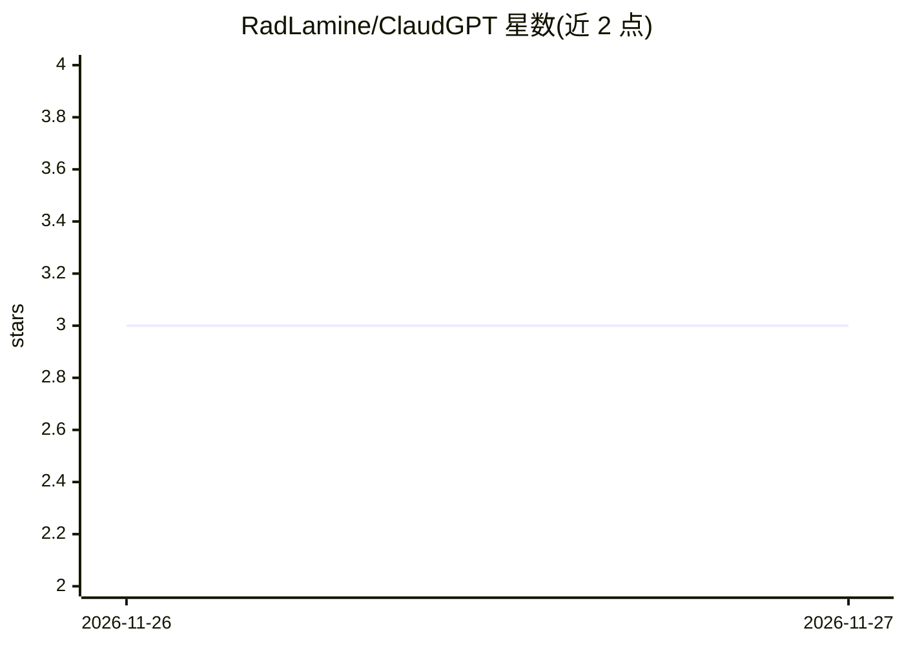

# RadLamine/ClaudGPT

⭐ 3 · Python · MIT · 推送 2026-11-24 · [GitHub](https://github.com/RadLamine/ClaudGPT) · 个人维护

**面向 Telegram 用户的 Python 多功能 AI 机器人**

基于 Python/aiogram 构建的 Telegram 机器人，将 AI 对话、代码生成与审查、图像理解、语音转录、文本转语音、图像生成、PDF 处理与背景移除整合在单一入口。机制上按服务划分有界队列（chat/vision/tts/stt/pdf 等通道），配合每用户限流、重复任务检查、多 API key 与模型故障转移冷却、内存/磁盘/数据库监控及紧急模式。默认部署为单进程 SQLite + 长轮询；内置的定时全量清理会删除用户与会话记录，README 提示生产部署前需备份 bot_data.db。MIT 许可，README 为英文。

## 筛选速览

| 维度 | 判定 | 备注 |
|---|---|---|
| AI 角色 | `ai-native` | 本体是模型或模型工具 |
| 许可风险 | `permissive` | MIT |
| 部署形态 | `library` | 以包/库形式分发 |
| 模型依赖 | locked-api |  |
| 硬件要求 | — | 无带数字的原话,不猜 |
| 安装摩擦 | `medium` | 含编译或系统依赖之一 |
| 成熟度 | — | 结构信号不足 |

## 能力要点

- 按服务划分的 10 条有界队列与每用户轮询调度
- 多 Groq API key + 模型 ID 故障转移与配额冷却
- 资源监控与紧急模式：暂停重负载队列、保护受限主机
- 阿拉伯语/英语双语界面

## 适用场景

- 在 Telegram 群组中提供 AI 问答与写作/翻译/编程辅助
- 发送 PDF、语音或 ZIP 项目让机器人转录、摘要或审查代码
- 给受资源限制的主机部署带队列与紧急保护的机器人服务

## 场景标签

`聊天机器人` `图像生成` `语音合成` `语音识别` · 领域:对话与助手

## 证据(README 行号)

> L5: ClaudGPT brings AI chat, programming help, file and project review, image understanding, speech transcription, text-
> L20: - **Provider and model resilience:** the AI router can try multiple configured Groq API keys and model IDs, applyin

## 星数曲线

2026-11-26 3 → 2026-11-27 3（+0）

---
*卡片 v1 · prompt 1.4 · 生成 2026-11-26 · 置信度 high · 依据 README sha `01a8c5b86507` · [字段定义](../../DATASET.md)*
