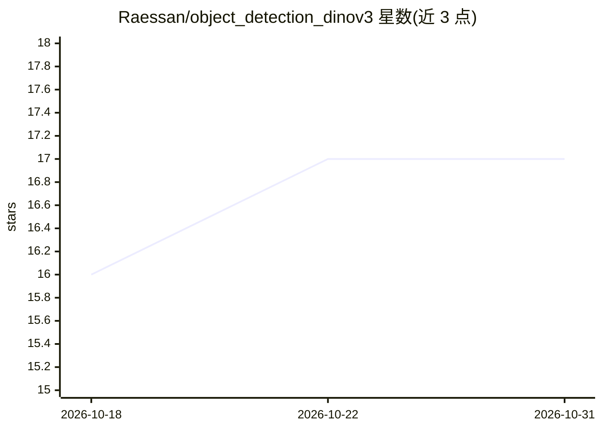

# Raessan/object_detection_dinov3

⭐ 17 · Python · Apache-2.0 · 推送 2026-01-03 · [GitHub](https://github.com/Raessan/object_detection_dinov3) · 个人维护

**基于 DINOv3 骨干的轻量级 FCOS 目标检测头**

Meta DINOv3 骨干之上的轻量目标检测头实现：LightFPN 三级特征金字塔（P3-P5）加 FCOS 风格 anchor-free 检测头，用 Focal Loss + GIoU + Centerness 组合损失在 COCO 上训练 30 epochs，提供权重文件、训练 notebook 与推理脚本。作为 dinov3_ros 项目的一部分，用于 ROS 2 实时检测并复用骨干特征；骨干权重需另行从 DINOv3 仓库申请，另提供 ONNX 导出以配合 TensorRT。

## 筛选速览

| 维度 | 判定 | 备注 |
|---|---|---|
| AI 角色 | `ai-native` | 本体是模型或模型工具 |
| 许可风险 | `permissive` | Apache-2.0 |
| 部署形态 | `library` | 以包/库形式分发 |
| 模型依赖 | — | README 未给出锁定关系 |
| 硬件要求 | — | 无带数字的原话,不猜 |
| 安装摩擦 | `medium` | 含编译或系统依赖之一 |
| 成熟度 | — | 结构信号不足 |

## 能力要点

- LightFPN + FCOS anchor-free 检测头， attaches 到 DINOv3（vits16plus）骨干
- 提供训练权重、训练 notebook（train_detector.ipynb）与推理脚本
- ONNX 导出器用于 dinov3_ros_tensorrt/TensorRT 部署
- 设计为即插即用集成到 dinov3_ros 项目

## 适用场景

- 在 DINOv3 骨干上做目标检测的推理或继续训练
- 为 ROS 2 机器人感知任务复用 DINOv3 特征做检测
- 导出 ONNX 模型以 TensorRT 运行

## 场景标签

`目标检测` · 领域:感知与多模态

## 证据(README 行号)

> L3: This repository provides a lightweight object detection head designed to run on top of Meta’s DINOv3 backbone. The m
> L5: This head is part of the dinov3_ros project, where it enables real-time object detection in ROS 2 by reusing backbon

## 星数曲线

2026-10-18 16 → 2026-10-31 17（+1）

---
*卡片 v1 · prompt 1.4 · 生成 2026-10-30 · 置信度 high · 依据 README sha `6f8e6e398605` · [字段定义](../../DATASET.md)*
