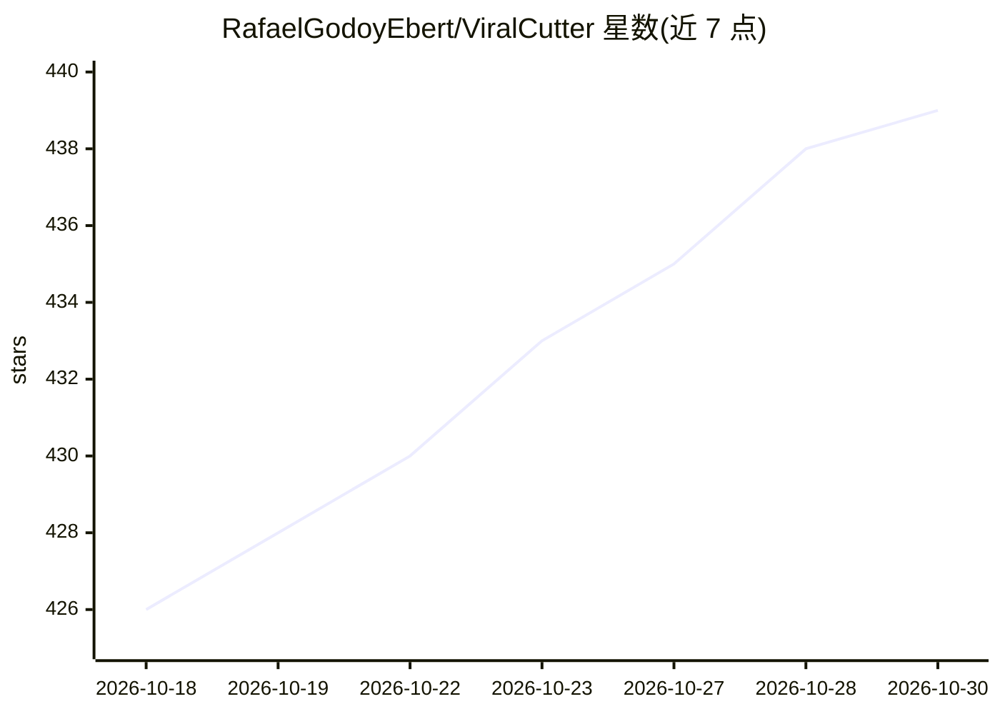

# RafaelGodoyEbert/ViralCutter

⭐ 439 · Python · GPL-3.0 · 推送 2026-09-10 · [GitHub](https://github.com/RafaelGodoyEbert/ViralCutter) · 个人维护

**本地免费工具：把 YouTube 长视频剪成 TikTok/Reels 竖版短视频**

面向内容创作者的本地视频剪辑工具：读取 YouTube 长视频，使用 Gemini、GPT-4 或本地 GGUF 模型识别高-engagement 片段并自动切片，基于 WhisperX 做 GPU 加速转录生成逐词高亮字幕，支持 9:16 自动裁剪、双人分屏、说话人切换（实验性）、字幕翻译到 10+ 语言及 Premiere Pro XML 导出（Beta）。以 Gradio WebUI 与 CLI 两种形式运行，通过 uv 管理依赖，安装分标准与本地 LLM 两条脚本路径；当前版本为 0.8v Alpha，需 Python 3.10/3.11、FFmpeg，本地模式需 C++ Build Tools 与 NVIDIA GPU。

## 筛选速览

| 维度 | 判定 | 备注 |
|---|---|---|
| AI 角色 | `ai-native` | 本体是模型或模型工具 |
| 许可风险 | `viral` | GPL-3.0 |
| 部署形态 | `None` |  |
| 模型依赖 | local-ok | 支持本地模型 |
| 硬件要求 | — | 无带数字的原话,不猜 |
| 安装摩擦 | `medium` | 含编译或系统依赖之一 |
| 成熟度 | `idea` | |

## 能力要点

- AI 切片：Gemini/GPT-4/本地 GGUF（Llama 3、DeepSeek 等）识别病毒式片段
- WhisperX GPU 加速转录与逐词高亮动态字幕
- 9:16 自动裁剪、双人分屏、说话人切换（实验性）
- 字幕翻译 10+ 语言与 Premiere Pro XML 导出（Beta）

## 适用场景

- 把长视频/播客切成 TikTok、Reels、Shorts 竖版短片
- 不把素材上传云端，在本地完成转录、剪辑与字幕
- 用本地 GGUF 模型离线完成片段挑选

## 场景标签

`图像视频处理` `语音识别` · 领域:感知与多模态

## 证据(README 行号)

> L31: - 🤖 **Corte Viral com IA**: Identifica automaticamente os ganchos e momentos mais engajadores usando **Gemini**, **
> L32: - 🗣️ **Transcrição Ultra-Precisa**: Baseado em **WhisperX** com aceleração via GPU para legendas perfeitas.

## 星数曲线

2026-10-18 426 → 2026-10-30 439（+13）

---
*卡片 v1 · prompt 1.4 · 生成 2026-10-21 · 置信度 high · 依据 README sha `0159054ef851` · [字段定义](../../DATASET.md)*
