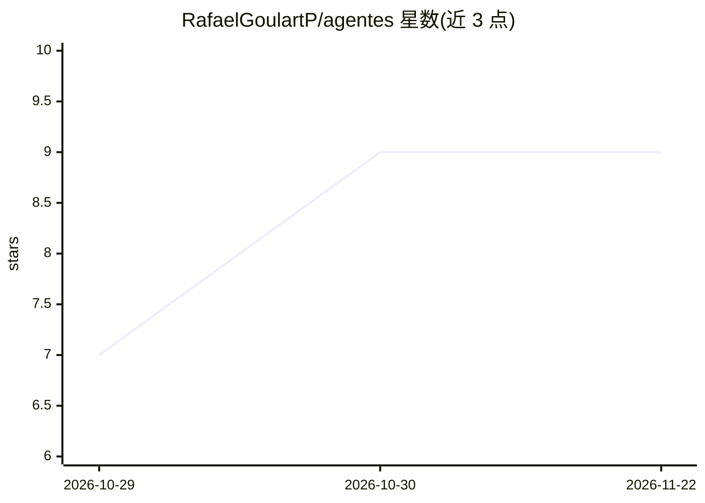

# RafaelGoulartP/agentes

⭐ 9 · JavaScript · MIT · 推送 2026-10-28 · [GitHub](https://github.com/RafaelGoulartP/agentes) · [官网](https://github.com/RafaelGoulartP/agentes#readme) · 个人维护 · 中文 README

**自托管的 GitHub issue→PR 编码代理编排系统**

面向开发者的自托管实验室：给 issue 打上 claude/codex 标签后，编排器在隔离 Docker 房间中让编码代理工作，代码经 git bundle 进出房间且代理不接触 GitHub token，结果在无凭据的干净房间中重跑测试后开 PR。每个房间有 Squid 出站代理白名单、Docker-in-Docker、CPU/内存/进程限制；提供 Web 面板、持久队列、配额暂停恢复、area 标签互斥与任务依赖编排，合并始终由人完成。

## 筛选速览

| 维度 | 判定 | 备注 |
|---|---|---|
| AI 角色 | `ai-ecosystem` | LLM/agent 周边工具 |
| 许可风险 | `permissive` | MIT |
| 部署形态 | `library` | 以包/库形式分发 |
| 模型依赖 | locked-api |  |
| 硬件要求 | — | 无带数字的原话,不猜 |
| 安装摩擦 | `low` | 无编译、无系统依赖或容器化 |
| 成熟度 | `idea` | |

## 能力要点

- issue 标签触发任务队列，最多 3 个房间并行
- 干净房间独立复验测试，代理无法削弱测试
- 房间无 GitHub token、出站域名白名单代理、Docker-in-Docker 与资源限制
- Web 面板含日志脱敏、PR 预览、Web Push 通知与多项目管理

## 适用场景

- 睡前给仓库提 issue，早上审查代理开出的 PR
- 在不暴露 token 的隔离环境中跑编码代理
- 用 area 标签和 depende de 编排多任务并行与依赖

## 场景标签

`编码 Agent` · 领域:编码与开发

## 证据(README 行号)

> L19: > **Você dorme, os agentes trabalham.** Coloque a etiqueta `claude` ou `codex` numa issue e o
> L30: 2. O orquestrador abre uma **sala** isolada e o agente trabalha numa cópia do código, sem o token do GitHub.
> L53:  controlador, fora das salas, faz `push` (nunca `--force`) e abre o PR.

## 星数曲线

2026-10-29 7 → 2026-11-22 9（+2）

---
*卡片 v1 · prompt 1.4 · 生成 2026-11-20 · 置信度 mid · 依据 README sha `96740f90813f` · [字段定义](../../DATASET.md)*
