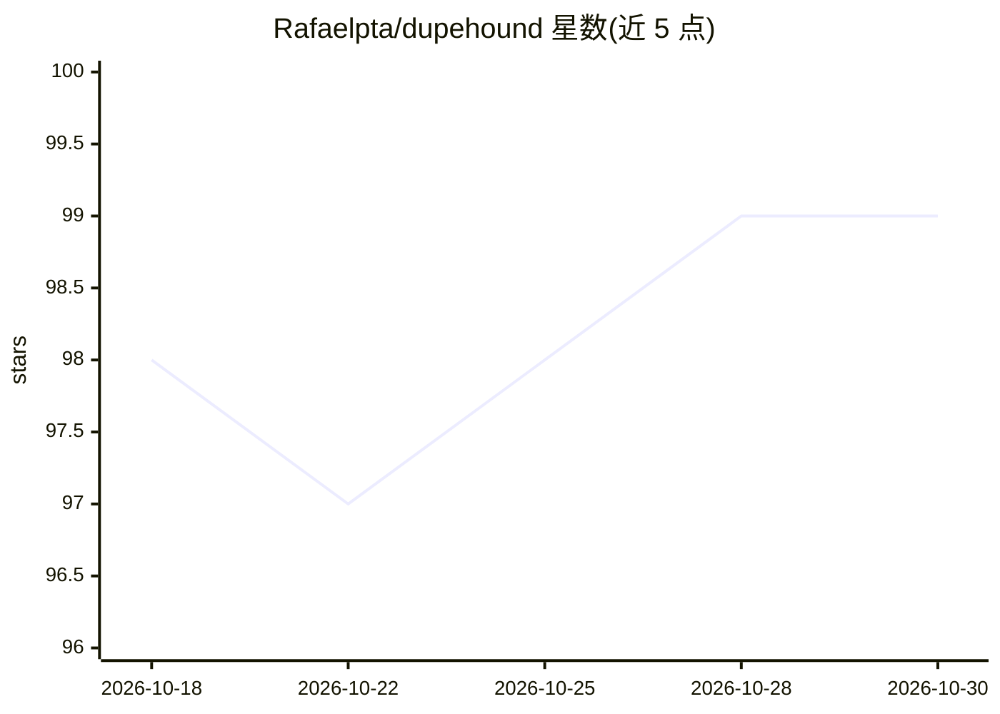

# Rafaelpta/dupehound

⭐ 99 · Rust · MIT · 推送 2026-09-21 · [GitHub](https://github.com/Rafaelpta/dupehound) · 个人维护

**离线重复代码检测器：发现 AI 生成的重复函数并做 CI 门禁**

面向 AI 大量写码的代码库的重复代码检测 CLI 工具。通过 tree-sitter 解析与 winnowing 指纹对函数做结构归一化（标识符/字面量替换为哨兵值），即使全部重命名也能匹配重复；经倒排索引与 Jaccard 相似度聚类。提供 scan（重复簇与 slop 分数）、history（按月快照图示重复演化）、check（CI/pre-commit 门禁，指出可复用的原函数并建议 import）、mcp（以 MCP server 供编码 agent 调用）。本地离线运行，无网络、API key 与 AI 依赖；history/check 需 git。安装支持脚本、Homebrew、cargo 与预编译二进制。

## 筛选速览

| 维度 | 判定 | 备注 |
|---|---|---|
| AI 角色 | `ai-ecosystem` | LLM/agent 周边工具 |
| 许可风险 | `permissive` | MIT |
| 部署形态 | `desktop` | 安装包/桌面程序 |
| 模型依赖 | — | README 未给出锁定关系 |
| 硬件要求 | — | 无带数字的原话,不猜 |
| 安装摩擦 | `low` | 无编译、无系统依赖或容器化 |
| 成熟度 | — | 结构信号不足 |

## 能力要点

- 结构指纹匹配：重命名后的复制函数仍可检出
- scan/history/check/mcp 四个命令，含 CI 门禁与 MCP server 模式
- 本地离线、确定性运行，无需网络与 API key
- 支持 TypeScript/Python/Rust/Go/Java 等 17 种语言

## 适用场景

- 在 CI 或 pre-commit 中拦截重复造轮子的代码
- 量化 AI 编码 agent 造成的代码重复趋势
- 让编码 agent 通过 MCP 工具即时复用已有代码

## 场景标签

 · 领域:开发者工具/静态分析

## 证据(README 行号)

> L13: dupehound is a duplicate-code detector built for codebases where agents write most of the code. It finds functions 
> L21: Everything runs locally and deterministically (no network, API keys, or AI required).
> L115: `dupehound mcp` runs as an MCP server over stdio, exposing `check` and `scan` as tools an AI coding agent can call

## 星数曲线

2026-10-18 98 → 2026-10-30 99（+1）

---
*卡片 v1 · prompt 1.4 · 生成 2026-10-23 · 置信度 high · 依据 README sha `cdf378ce30d0` · [字段定义](../../DATASET.md)*
