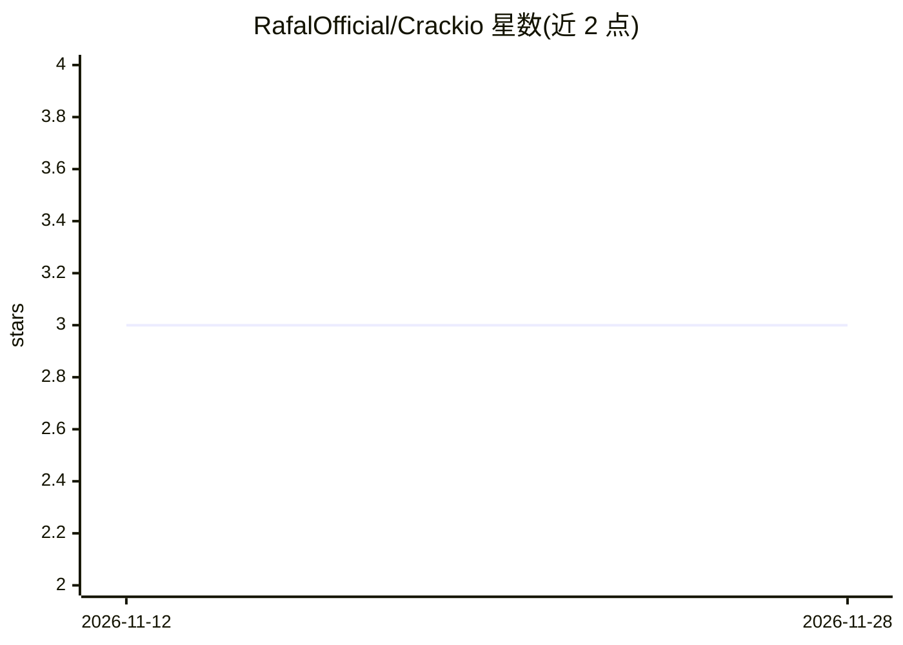

# RafalOfficial/Crackio

⭐ 3 · TypeScript · MIT · 推送 2026-11-22 · [GitHub](https://github.com/RafalOfficial/Crackio) · [官网](https://crackio.pages.dev) · 个人维护

**本地 GPU 上的开源 AI 图像视频工作室，基于 ComfyUI**

Crackio 是一个集 17 种工具于一体的图像与视频生成应用：3D 布景导演、分镜时间线、换脸换物、产品广告、重打光、重取景、修复、放大，以及语音合成与口型同步。所有任务以 ComfyUI 图运行在用户自己的 GPU 或租用 GPU/Comfy 云上，每个结果保留完整 ComfyUI 工作流。需 Node.js 22.13+，Windows/macOS/Linux 可用，无账号无订阅，MIT 许可。部分工具需外部 API key（Comfy Router、RunPod 等）。

## 筛选速览

| 维度 | 判定 | 备注 |
|---|---|---|
| AI 角色 | `ai-native` | 本体是模型或模型工具 |
| 许可风险 | `permissive` | MIT |
| 部署形态 | `library` | 以包/库形式分发 |
| 模型依赖 | — | README 未给出锁定关系 |
| 硬件要求 | — | 无带数字的原话,不猜 |
| 安装摩擦 | `medium` | 含编译或系统依赖之一 |
| 成熟度 | — | 结构信号不足 |

## 能力要点

- 17 种图像/视频工具，任务以 ComfyUI 图运行并保留完整工作流
- 自动检测本机硬件并选择适配模型，生成前预估耗时
- 支持本机 GPU、局域网第二台电脑、租用 GPU（RunPod/vast.ai）与 Comfy 云
- 语音合成、克隆与口型同步（LatentSync 1.6 / HuMo 17B）在本地 GPU 运行

## 适用场景

- 在自己的 GPU 上生成图片与视频而不上传文件
- 用 3D 布景和分镜时间线拍出短片
- 给电商产品图生成广告短片与重打光
- 修改视频中人物台词并只重绘口型

## 场景标签

`图像生成` `视频生成` `语音合成` · 领域:内容生成

## 证据(README 行号)

> L13: Crackio is a full AI studio for pictures and video: stage a shot on a 3D set, cut a film together, swap anyone or a
> L88:  Image Image Type what you want in any language, add reference pictures or @ someone from your Cast, and press Gene
> L41: |**A GPU (optional)**|NVIDIA GTX 10 or newer, Apple silicon, AMD or Intel Arc. No GPU? Use RunPod Serverless, a ren

## 星数曲线

2026-11-12 3 → 2026-11-28 3（+0）

---
*卡片 v1 · prompt 1.4 · 生成 2026-11-22 · 置信度 high · 依据 README sha `3f781dc28b7e` · [字段定义](../../DATASET.md)*
