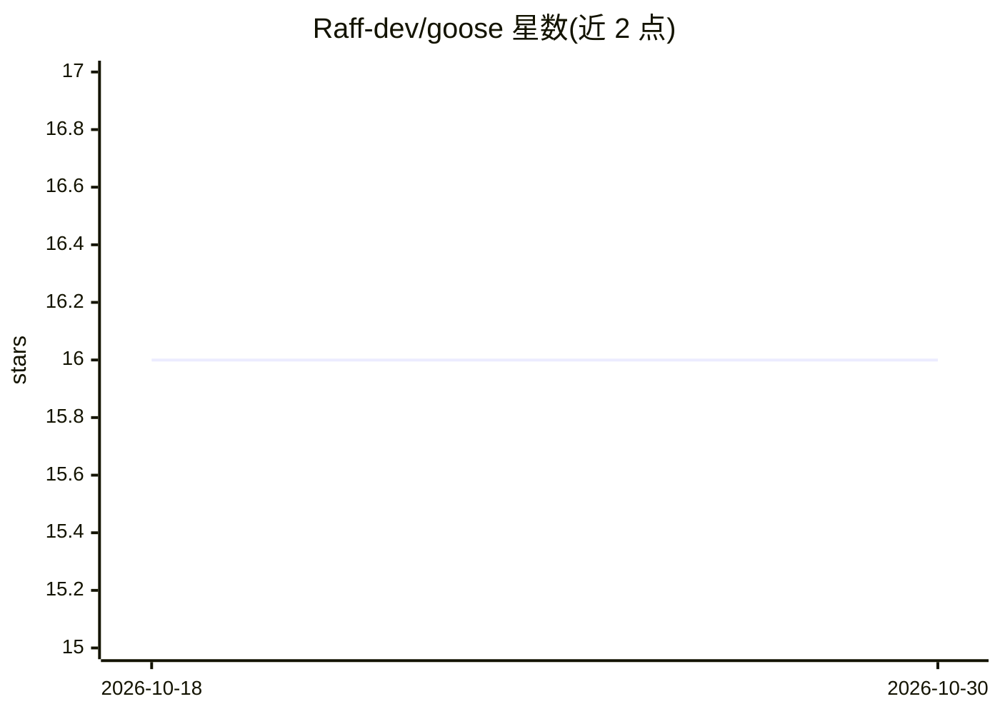

# Raff-dev/goose

⭐ 16 · Python · MIT · 推送 2026-06-03 · [GitHub](https://github.com/Raff-dev/goose) · 个人维护

**LLM agent 测试调试库：会话场景测试+追踪+实时聊天**

以 Python 库、CLI 和 Web 仪表盘三种形式提供的 LLM agent 测试与调试工具：通过 goose init 生成 gooseapp 脚手架，接入用户真实的 query 函数，用 goose.case 编写自然语言期望与工具调用断言的测试用例，记录完整执行轨迹（消息、工具调用、输出、校验结果）。框架无关为默认路径，另提供 LangChain/LangGraph 集成文档；仪表盘支持实时对话调试与热重载。pip 安装，浏览器 UI 需另装 npm 包。MIT 许可。

## 筛选速览

| 维度 | 判定 | 备注 |
|---|---|---|
| AI 角色 | `ai-ecosystem` | LLM/agent 周边工具 |
| 许可风险 | `permissive` | MIT |
| 部署形态 | `library` | 以包/库形式分发 |
| 模型依赖 | — | README 未给出锁定关系 |
| 硬件要求 | — | 无带数字的原话,不猜 |
| 安装摩擦 | `low` | 无编译、无系统依赖或容器化 |
| 成熟度 | — | 结构信号不足 |

## 能力要点

- 自然语言期望描述与工具调用断言两类校验
- 完整执行轨迹记录（消息/工具调用/输出/校验结果）
- 仪表盘实时对话与热重载
- 框架无关接入，另提供 LangChain/LangGraph 集成

## 适用场景

- 为已有 LLM agent 写可重复的会话场景测试
- 调试时在仪表盘中实时对话并热重载迭代 agent
- 校验 agent 的工具调用行为而非仅回复文本

## 场景标签

`模型评测` `LLM 可观测性` · 领域:评测与运维

## 证据(README 行号)

> L12:  Goose is a Python library, CLI, and web dashboard for testing and debugging LLM agents.
> L26: - **Natural-language expectations** – Describe the behavior you want and let Goose validate it.

## 星数曲线

2026-10-18 16 → 2026-10-30 16（+0）

---
*卡片 v1 · prompt 1.4 · 生成 2026-10-30 · 置信度 mid · 依据 README sha `e3c18bd6946a` · [字段定义](../../DATASET.md)*
