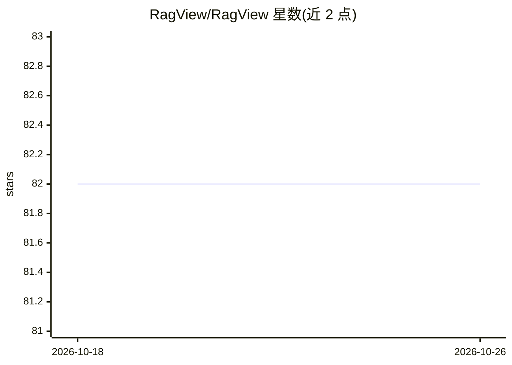

# RagView/RagView

⭐ 82 · 推送 2025-12-05 · [GitHub](https://github.com/RagView/RagView) · [官网](https://ragview.ai/) · 组织维护

**面向开发者和企业的 RAG 方案评测与选型平台**

RagView 是一个托管在 RagView.ai 上的 RAG 技术基准评测平台：用户上传文档集与测试集（XLSX/JSON），选择多个 RAG 方案（已集成 Langflow、R2R、GraphRAG、LightRAG、DocsGPT），平台统一执行评测并计算答案准确率、上下文精确率/召回率、延迟与 token 消耗等指标，支持按查询和任务两级查看结果。按评测次数计费，每评一个方案消耗一个计数。当前不开源（仅计划开源优化的 RAG 方案），文档集仅支持 PDF，测试集自动生成、自有方案接入等功能列于里程碑计划中。

## 筛选速览

| 维度 | 判定 | 备注 |
|---|---|---|
| AI 角色 | `ai-ecosystem` | LLM/agent 周边工具 |
| 许可风险 | `none` | — |
| 部署形态 | `None` |  |
| 模型依赖 | — | README 未给出锁定关系 |
| 硬件要求 | — | 无带数字的原话,不猜 |
| 安装摩擦 | `low` | 无编译、无系统依赖或容器化 |
| 成熟度 | `idea` | |

## 能力要点

- 统一评测多种开源 RAG 方案（已集成 R2R、Langflow、DocsGPT、GraphRAG、LightRAG）
- 功能指标（答案准确率/上下文精确率/召回率）与性能指标（延迟/token 消耗/资源用量）
- 查询级与任务级两级评测结果展示
- 评测方案路线图覆盖 KAG、dsRAG、paper-qa、cognee、trustgraph、graphiti 等

## 适用场景

- 在我自己的文档数据上对比多个开源 RAG 方案的召回率与准确率
- 结合延迟和 token 成本为业务选择合适的 RAG 方案
- 查看单条查询的检索与生成细节及指标计算过程

## 场景标签

`模型评测` · 领域:评测与运维

## 证据(README 行号)

> L6: To address this gap, we are building RagView—a benchmarking and selection platform for RAG technologies, designed fo
> L17: - RAG evaluation Task: Consists of one document set, one test set, and N user-selected RAG solutions; it executes t

## 星数曲线

2026-10-18 82 → 2026-10-26 82（+0）

---
*卡片 v1 · prompt 1.4 · 生成 2026-10-24 · 置信度 high · 依据 README sha `d847048a7a27` · [字段定义](../../DATASET.md)*
