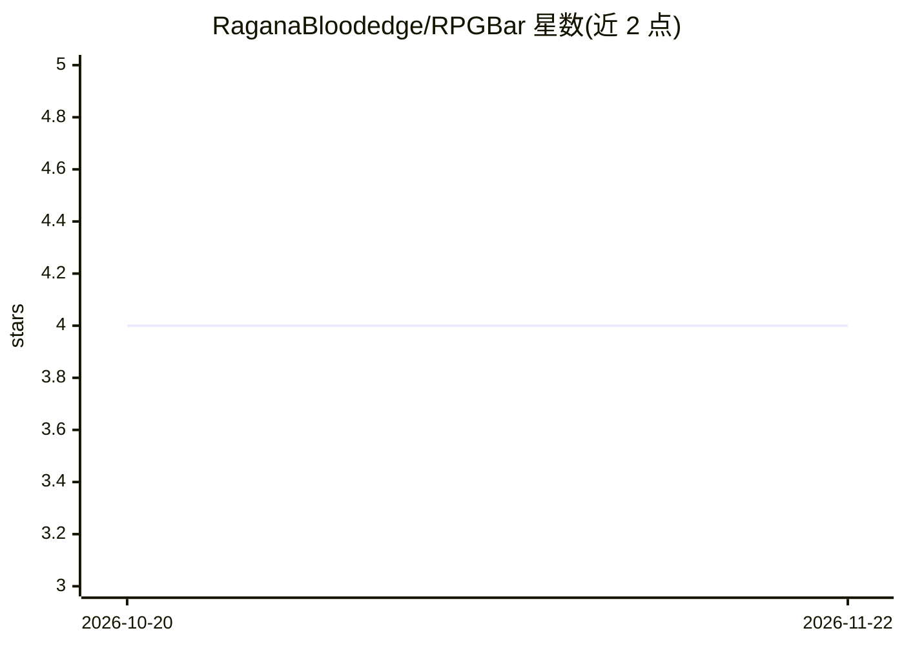

# RaganaBloodedge/RPGBar

⭐ 4 · Python · MIT · 推送 2026-11-08 · [GitHub](https://github.com/RaganaBloodedge/RPGBar) · 个人维护 · 中文 README

**多人联机文字跑团：Agent 当 DM，RAG 约束剧情**

基于 FastAPI + WebSocket 的多人联机 TRPG demo：服务器跑在某个玩家的 PC 上，其他玩家浏览器连入大厅/房间联机。Agent 担任 DM，RAG（BM25+向量混合检索）约束其遵循剧本，剧情状态机与服务端权威骰子护栏防编造；剧本外 NPC 由小模型生成人物小传，玩家各有只读小助手。模型经三条通道接入：OpenAI 兼容云 API、本地 llama.cpp/Ollama/LM Studio、自研 C++ 内置引擎（CPU/CUDA 双后端，GGUF 权重）；无脚本化兜底，未接模型无法开局。

## 筛选速览

| 维度 | 判定 | 备注 |
|---|---|---|
| AI 角色 | `ai-native` | 本体是模型或模型工具 |
| 许可风险 | `permissive` | MIT |
| 部署形态 | `desktop` | 安装包/桌面程序 |
| 模型依赖 | local-ok | 支持本地模型 |
| 硬件要求 | — | 无带数字的原话,不猜 |
| 安装摩擦 | `medium` | 含编译或系统依赖之一 |
| 成熟度 | `idea` | |

## 能力要点

- 三个 Agent（DM 大模型 + 两个小模型助手）按工具调用循环实现，护栏做在工具集与校验器里
- 三路模型通道：云 API / llama.cpp、Ollama 等本地 OpenAI 兼容服务 / 自研 C++ 内置引擎（CPU 与 CUDA）
- RAG 混合检索：jieba 分词 BM25 + 内置 bge-small-zh-v1.5（ONNX）向量，RRF 融合，缺失时降级纯 BM25
- 服务端权威骰子与剧情状态机，无模型产出时显式失败不伪造

## 适用场景

- 和朋友在局域网或内网穿透环境下联机跑一局文字 TRPG
- 用本地小模型离线运行整局跑团，不依赖云服务
- 为自己的剧本（JSON 或 Markdown/文本）快速开一局 AI 主持的团

## 场景标签

`RAG` `聊天机器人` · 领域:对话与助手

## 证据(README 行号)

> L3: 多人联机文字跑团（TRPG）。一个 Agent 担任 DM，用 RAG 约束 DM 遵循剧本推进剧情；玩家通过浏览器连接**服务器**实时联机，各自可召唤小助手草拟行动，骰子由服务端统一投掷。剧本外的路人 NPC 由主机小助手现场生
> L62: > ① 内置引擎（全离线，见下）；② 任意 OpenAI 兼容的云 API 或本地 `llama.cpp` / Ollama。
> L266: - **守剧本 = RAG + 状态机双保险**：RAG 给 DM 递当前场景与相关片段，状态机管「剧情走到哪、允许往哪走」。

## 星数曲线

2026-10-20 4 → 2026-11-22 4（+0）

---
*卡片 v1 · prompt 1.4 · 生成 2026-11-21 · 置信度 mid · 依据 README sha `e58a38e119f4` · [字段定义](../../DATASET.md)*
