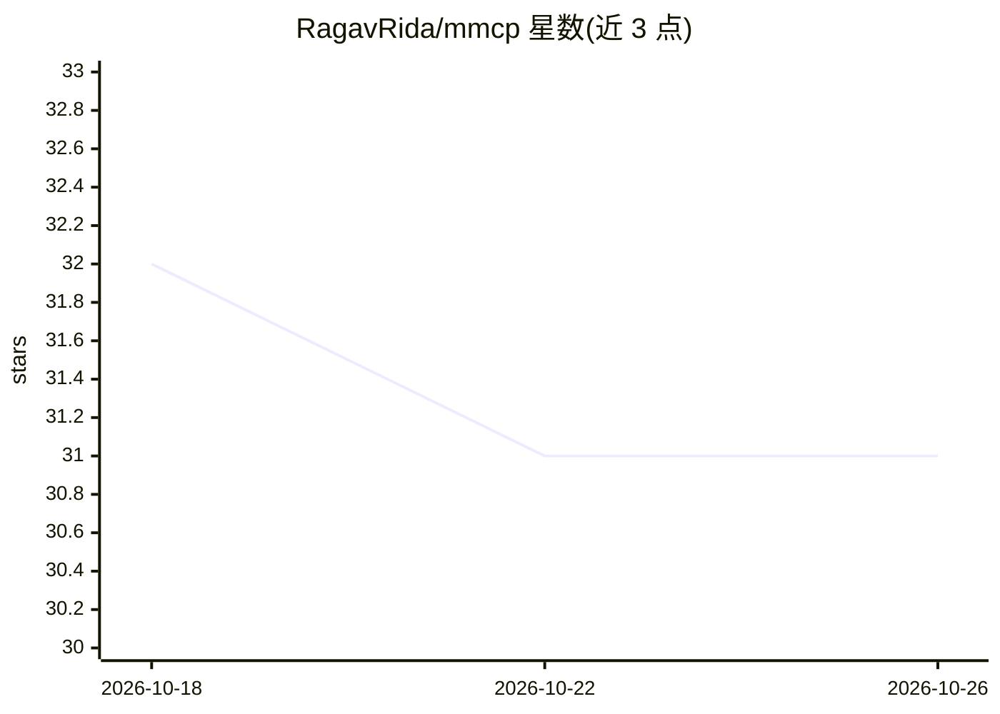

# RagavRida/mmcp

⭐ 31 · TypeScript · MIT · 推送 2026-06-03 · [GitHub](https://github.com/RagavRida/mmcp) · 个人维护

**多模型协作编排框架：按领域 RL 路由将 AI 模型组织为 DAG**

以 TypeScript/Python 包与 CLI 形式提供的多模型编排平台：按任务领域学习各模型得分（RL 路由，UCB1/ε-greedy），自动选择模型并以 Chain/Fork/Verify/Shard/Handoff 五种操作组成 DAG 流水线；支持 Anthropic、OpenAI、Google、Meta、DeepSeek、Mistral 等多家提供商。提供多验证者投票、跨框架 Agent 协调（共享记忆、handoff、自动发现）、执行持久化与检查点恢复、HTTP Agent 协议。无 API key 用户可用托管的 MMCP Cloud（含付费套餐），BYOK 模式可自带密钥。

## 筛选速览

| 维度 | 判定 | 备注 |
|---|---|---|
| AI 角色 | `ai-ecosystem` | LLM/agent 周边工具 |
| 许可风险 | `permissive` | MIT |
| 部署形态 | `library` | 以包/库形式分发 |
| 模型依赖 | locked-api |  |
| 硬件要求 | — | 无带数字的原话,不猜 |
| 安装摩擦 | `low` | 无编译、无系统依赖或容器化 |
| 成熟度 | — | 结构信号不足 |

## 能力要点

- 按领域学习模型得分并自动路由的 Domain RL Router（UCB1/ε-greedy）
- Chain/Fork-Merge/Verify/Shard/Handoff 五种 DAG 协议操作
- 多验证者投票（majority/unanimous/weighted）与自我改进反馈回路
- 跨框架 Agent 协调：共享记忆、无状态丢失 handoff、自动发现

## 适用场景

- 让框架自动为代码、数学、写作等不同任务挑选合适的模型
- 用 Producer→Challenger→Judge 模式做多模型对抗式事实核查
- 把 LangChain/CrewAI/AutoGen 等异构 agent 接入共享上下文协同工作
- 长文档分片并行处理后再合并

## 场景标签

`Agent 框架` `多智能体` · 领域:Agent 开发

## 证据(README 行号)

> L3: **Orchestrate AI models as a coordinated DAG. RL routing · Multi-verifier voting · Agent mesh · Self-improving.**
> L268: |🧠 **Domain RL Router**|Learns per-domain scores (code, math, writing, security) — routes to the best model FOR TH

## 星数曲线

2026-10-18 32 → 2026-10-26 31（-1）

---
*卡片 v1 · prompt 1.4 · 生成 2026-10-26 · 置信度 high · 依据 README sha `8a2f54e96c6b` · [字段定义](../../DATASET.md)*
