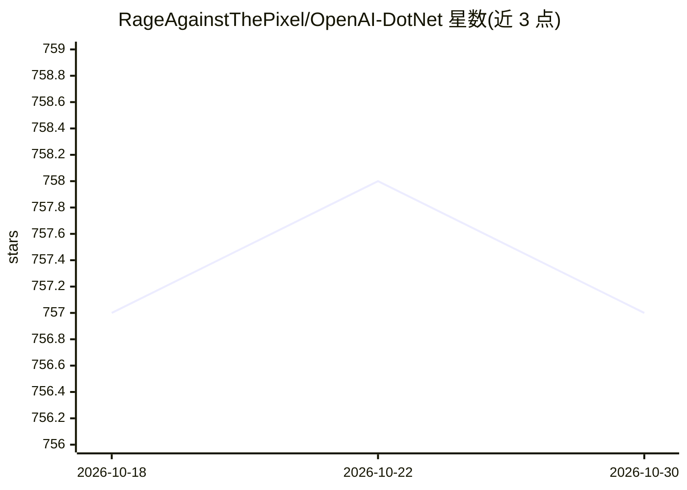

# RageAgainstThePixel/OpenAI-DotNet

⭐ 757 · C# · MIT · 推送 2026-01-24 · [GitHub](https://github.com/RageAgainstThePixel/OpenAI-DotNet) · [官网](https://openai.com) · 个人维护

**面向 .NET 开发者的 OpenAI REST API 客户端库**

独立开发（非官方）的 C# .NET 客户端库，封装 OpenAI RESTful API：覆盖 Models、Responses 等端点，支持自定义 Model id、HttpClient 生命周期管理（内部创建则随客户端释放，外部传入需自行管理）。提供三种 API key 认证方式（构造函数传入、.openai 配置文件、环境变量），支持接入 Microsoft Azure OpenAI 部署（含 Azure Active Directory 认证），并配套 OpenAI-DotNet-Proxy 中间代理组件避免前端暴露密钥。目标 .NET 8.0 及以上，跨 Windows/Linux/Mac，另有 Unity 包（OpenUPM）。需自备 OpenAI API 账号。

## 筛选速览

| 维度 | 判定 | 备注 |
|---|---|---|
| AI 角色 | `ai-ecosystem` | LLM/agent 周边工具 |
| 许可风险 | `permissive` | MIT |
| 部署形态 | `None` |  |
| 模型依赖 | locked-api |  |
| 硬件要求 | — | 无带数字的原话,不猜 |
| 安装摩擦 | `medium` | 含编译或系统依赖之一 |
| 成熟度 | — | 结构信号不足 |

## 能力要点

- 封装 OpenAI RESTful API 的 .NET 8.0+ 客户端库（NuGet 分发）
- 支持 Azure OpenAI 部署与 Azure Active Directory 认证
- 配套 OpenAI-DotNet-Proxy 中间代理，避免前端应用暴露 API key
- 三种 API key 加载方式：构造函数/配置文件/环境变量

## 适用场景

- 在 C#/.NET 应用中调用 OpenAI 的模型与 Responses API
- 通过 Azure OpenAI 部署使用模型并接入 AAD 认证
- 搭建中间代理服务器保护前端应用的 API 密钥

## 场景标签

`模型网关` · 领域:Agent 开发

## 证据(README 行号)

> L9: A simple C# .NET client library for OpenAI to use though their RESTful API.
> L18: - This library targets .NET 8.0 and above.

## 星数曲线

2026-10-18 757 → 2026-10-30 757（+0）

---
*卡片 v1 · prompt 1.4 · 生成 2026-10-21 · 置信度 high · 依据 README sha `3551787cbd2f` · [字段定义](../../DATASET.md)*
