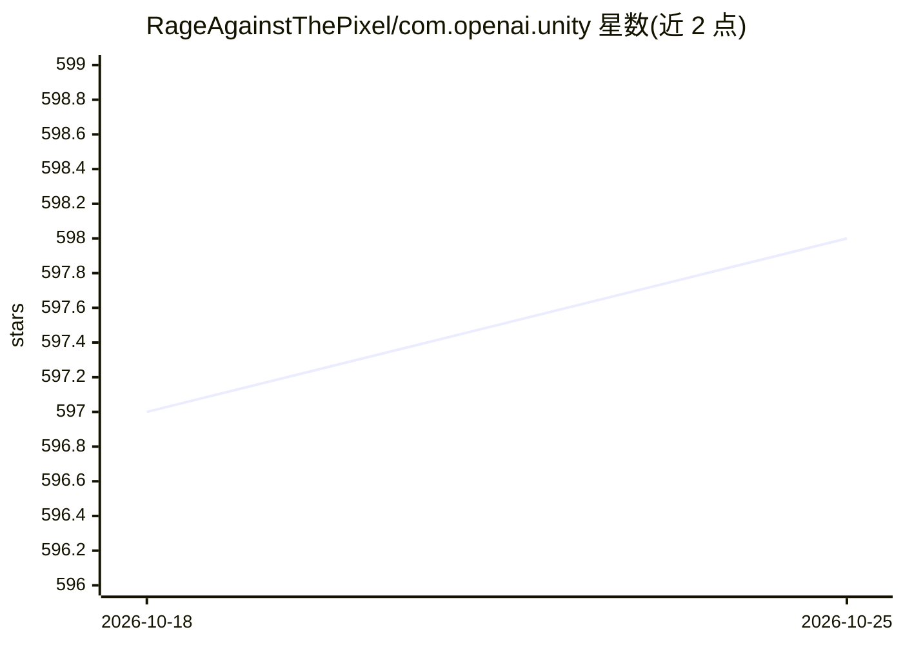

# RageAgainstThePixel/com.openai.unity

⭐ 598 · C# · MIT · 推送 2026-01-26 · [GitHub](https://github.com/RageAgainstThePixel/com.openai.unity) · [官网](https://openai.com) · 个人维护

**供 Unity 开发者调用 OpenAI REST API 的非官方客户端库**

基于 OpenAI-DotNet 的 Unity 包（UPM 格式），以 C# 封装 OpenAI REST API 的各类端点（Models、Responses 等），供 Unity 项目内直接调用。非官方独立开发，需自备 OpenAI API 账户。支持 4 种 API key 加载方式（构造函数/ScriptableObject/配置文件/环境变量），可配置接入 Azure OpenAI 部署与 Azure AD 认证，并给出以 OpenAI-DotNet-Proxy 中间层保护密钥的前后端示例。要求 Unity 2021.3 LTS 及以上。

## 筛选速览

| 维度 | 判定 | 备注 |
|---|---|---|
| AI 角色 | `ai-ecosystem` | LLM/agent 周边工具 |
| 许可风险 | `permissive` | MIT |
| 部署形态 | `None` |  |
| 模型依赖 | locked-api |  |
| 硬件要求 | — | 无带数字的原话,不猜 |
| 安装摩擦 | `medium` | 含编译或系统依赖之一 |
| 成熟度 | — | 结构信号不足 |

## 能力要点

- C# 封装 OpenAI REST API 各端点，Unity 内直接调用
- 支持 Azure OpenAI 部署与 Azure Active Directory 认证
- 4 种 API key 加载方式（构造函数/ScriptableObject/配置文件/环境变量）
- 提供基于 OpenAI-DotNet-Proxy 的密钥保护前后端配置方案

## 适用场景

- 在 Unity 游戏或应用中调用 GPT 对话、 Responses 等模型能力
- 将客户端指向 Azure OpenAI 部署
- 通过中间代理层避免前端暴露 API key

## 场景标签

 · 领域:游戏开发/AI SDK

## 证据(README 行号)

> L7: A OpenAI package for the Unity to use though their RESTful API.
> L158: ### Azure OpenAI

## 星数曲线

2026-10-18 597 → 2026-10-25 598（+1）

---
*卡片 v1 · prompt 1.4 · 生成 2026-10-21 · 置信度 high · 依据 README sha `b9e52107aa38` · [字段定义](../../DATASET.md)*
