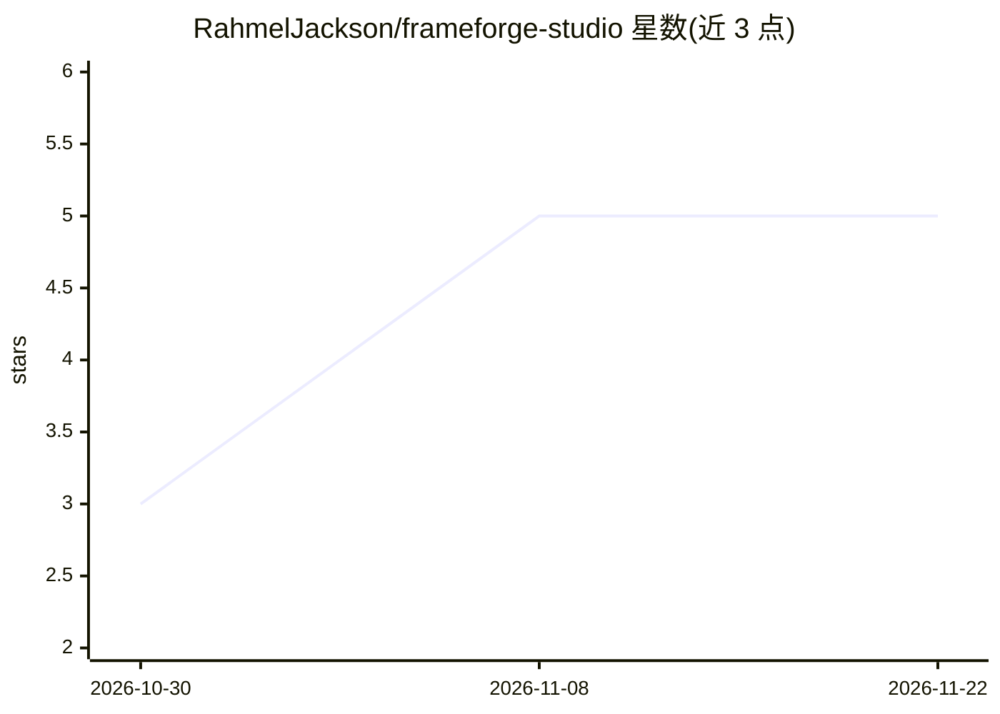

# RahmelJackson/frameforge-studio

⭐ — · [GitHub]() · 个人维护

**基于 ComfyUI 的本地创意工作室：生成图像视频音频短片**

围绕 ComfyUI 工作流构建的本地创意工作室前端，通过浏览器、ComfyUI 工具栏扩展或 MCP 面板接入自己的 ComfyUI，生成图像、视频、语音与短片，并可查看、编辑和导出真实工作流图。支持外部云端跳转（Comfy Cloud、Civitai），但生成在用户自己的账号侧进行，Studio 不存储凭据、不消耗积分。安装方式为源码 ZIP 解压后运行启动脚本，启动器可自动获取私有 Node 运行时，无需管理员权限或全局 npm 安装。

## 筛选速览

| 维度 | 判定 | 备注 |
|---|---|---|
| AI 角色 | `ai-native` | 本体是模型或模型工具 |
| 许可风险 | `permissive` | — |
| 部署形态 | `library` | 以包/库形式分发 |
| 模型依赖 | — | README 未给出锁定关系 |
| 硬件要求 | — | 无带数字的原话,不猜 |
| 安装摩擦 | `low` | 无编译、无系统依赖或容器化 |
| 成熟度 | — | 结构信号不足 |

## 能力要点

- 检查、编辑并导出真实 ComfyUI 工作流图
- 视频 Produce 流水线：规划镜头、逐帧渲染、Kokoro 旁白、导出粗剪与 OTIO 包
- STDIO MCP 服务器支持发现、图查看与本地生成工具，可由 MCP 客户端驱动
- Open weights 模式将执行限制为经审查的本地工作流

## 适用场景

- 用本地 ComfyUI 模型生成图像和短片
- 通过手机扫码远程监控和审批 PC 上的视频渲染
- 把创意片段组装成带字幕和旁白的成片
- 准备角色 LoRA 训练数据并在 Studio 内启动训练

## 场景标签

`图像生成` `视频生成` `语音合成` · 领域:内容生成

## 证据(README 行号)

> L3: **An open-source creative studio inspired by Higgsfield, built around ComfyUI workflows.**
> L5: Frameforge is a local creative studio over your own ComfyUI. Make images, video, voice and short films, inspect the 
> L48: - **Produce: one idea → a finished video.** Video → Produce plans the shots for a format, renders every keyframe an

## 星数曲线

2026-10-30 3 → 2026-11-22 5（+2）

---
*卡片 v1 · prompt 1.4 · 生成 2026-11-22 · 置信度 high · 依据 README sha `f23e32e59286` · [字段定义](../../DATASET.md)*
