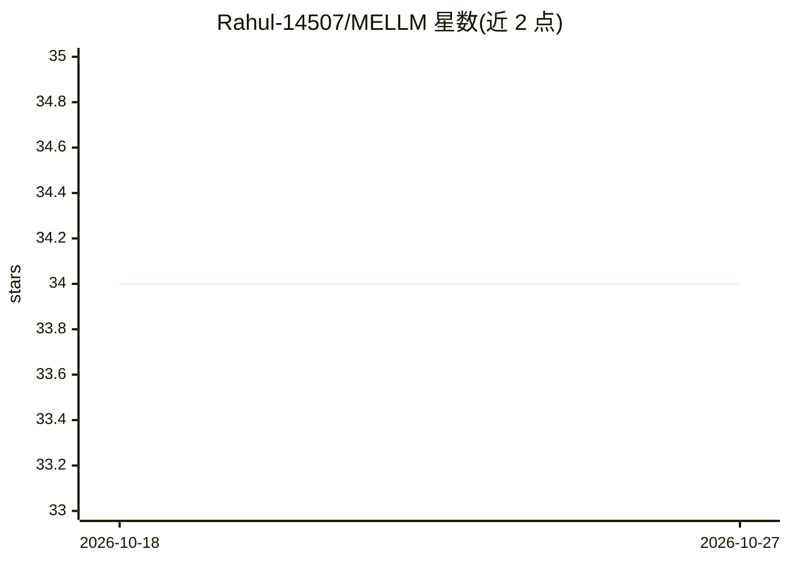

# Rahul-14507/MELLM

⭐ 34 · Python · MIT · 推送 2026-07-31 · [GitHub](https://github.com/Rahul-14507/MELLM) · 个人维护

**本地多专家 LLM 路由引擎：小模型分类查询并调度领域专家**

面向消费级 GPU（6GB 显存）的 Python 路由框架：用常驻显存的 1.5B 路由模型（Qwen2.5，JSON 输出模式）识别查询领域并改写提示词，按需加载/切换 GGUF 领域专家模型（代码/数学/医疗/法律/通用），跨域查询自动分解并行执行后合并。基于 llama-cpp-python 推理，模型首次使用时从 Hugging Face 自动下载；提供交互式 CLI、Web 界面与 FastAPI REST 端点。仅原生支持 Linux，Windows 需经 WSL2 运行。

## 筛选速览

| 维度 | 判定 | 备注 |
|---|---|---|
| AI 角色 | `ai-ecosystem` | LLM/agent 周边工具 |
| 许可风险 | `permissive` | MIT |
| 部署形态 | `library` | 以包/库形式分发 |
| 模型依赖 | local-ok | 支持本地模型 |
| 硬件要求 | `gpu-8g` | |
| 安装摩擦 | `medium` | 含编译或系统依赖之一 |
| 成熟度 | — | 结构信号不足 |

## 能力要点

- LLM-as-Router：1.5B 路由模型分类 5 个领域并改写提示词
- 两层显存驻留策略：路由常驻 + 单一活跃专家热缓存，适配 6GB 显存
- 跨域查询自动分解为多专家并行执行并合并响应
- 提供 FastAPI REST 端点与硬件感知的交互式安装向导

## 适用场景

- 在 6GB 显存的消费级 GPU 上运行多个领域专家小模型
- 用本地路由替代单个大模型回答不同领域的提问
- 通过 REST API 把本地专家路由能力接入其他应用

## 场景标签

`模型网关` `推理引擎` · 领域:Agent 开发

## 证据(README 行号)

> L19: MELLM is a lightweight AI router that:
> L109: - 🌐 **REST API** — FastAPI endpoint so any app can use MELLM as a backend
> L133: All models use the **GGUF** quantized format for efficient inference via `llama-cpp-python`.

## 星数曲线

2026-10-18 34 → 2026-10-27 34（+0）

---
*卡片 v1 · prompt 1.4 · 生成 2026-10-25 · 置信度 mid · 依据 README sha `ae865741c4b1` · [字段定义](../../DATASET.md)*
