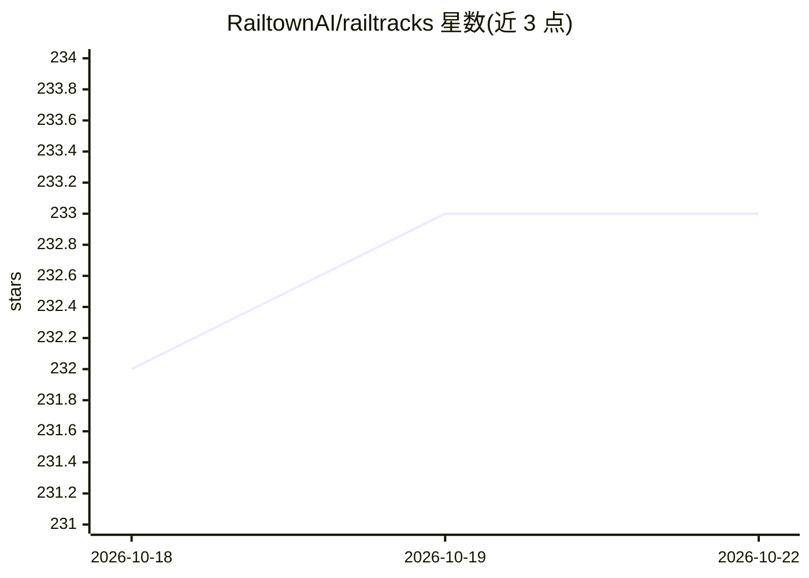

# RailtownAI/railtracks

⭐ 233 · Python · MIT · 推送 2026-10-21 · [GitHub](https://github.com/RailtownAI/railtracks) · [官网](https://docs.railtracks.org/) · 组织维护

**Python agent 框架：用纯 Python 组装自己的 agent 与 harness**

面向开发者的 Python agent 框架，将 agent harness 拆为五个可自选组装的部分：工具调用循环（agent_node/Flow）、工具面（function_node、ToolManifest、MCP 接入）、上下文管理、权限与预算控制（MaxCalls/Timeout/Retry/人审验证器），以及可回放的运行记录与本地可视化。附编码、研究、运维三类 harness 示例。无 YAML/DSL，与 asyncio 模式一致；支持 OpenAI、Anthropic、Google、Azure 等多家模型提供商，另提供 decision_node 做分类/路由决策，以及为 Claude Code 等 AI 编码助手生成配置的插件。

## 筛选速览

| 维度 | 判定 | 备注 |
|---|---|---|
| AI 角色 | `ai-ecosystem` | LLM/agent 周边工具 |
| 许可风险 | `permissive` | MIT |
| 部署形态 | `library` | 以包/库形式分发 |
| 模型依赖 | locked-api |  |
| 硬件要求 | — | 无带数字的原话,不猜 |
| 安装摩擦 | `low` | 无编译、无系统依赖或容器化 |
| 成熟度 | — | 结构信号不足 |

## 能力要点

- 纯 Python 组装 agent harness，无 YAML/DSL/黑盒运行时
- 内置权限与预算控制（MaxCalls、Timeout、Retry、人审验证器）与可回放运行记录
- 本地运行的可视化工具，实时查看 agent 运行与评测，无需注册
- decision_node 单次调用返回校准概率用于分类/路由/评级

## 适用场景

- 构建编码/研究/运维类 agent harness 并保留全部控制权
- 为高风险工具加人工审批与审计轨迹
- 实时查看与回放 agent 运行过程做调试

## 场景标签

`Agent 框架` `LLM 可观测性` · 领域:Agent 开发

## 证据(README 行号)

> L26: Railtracks is a Python **agent framework** for building your own **agents and/or harness**. Every piece is an ordin
> L38: Everything around the model call. The model brings judgment. The harness brings the loop that keeps calling it, the
> L145: Works with **OpenAI**, **Anthropic**, **Google**, **Azure**, and more. See the full provider list.

## 星数曲线

2026-10-18 232 → 2026-10-22 233（+1）

---
*卡片 v1 · prompt 1.4 · 生成 2026-10-22 · 置信度 high · 依据 README sha `655955fdc0a5` · [字段定义](../../DATASET.md)*
