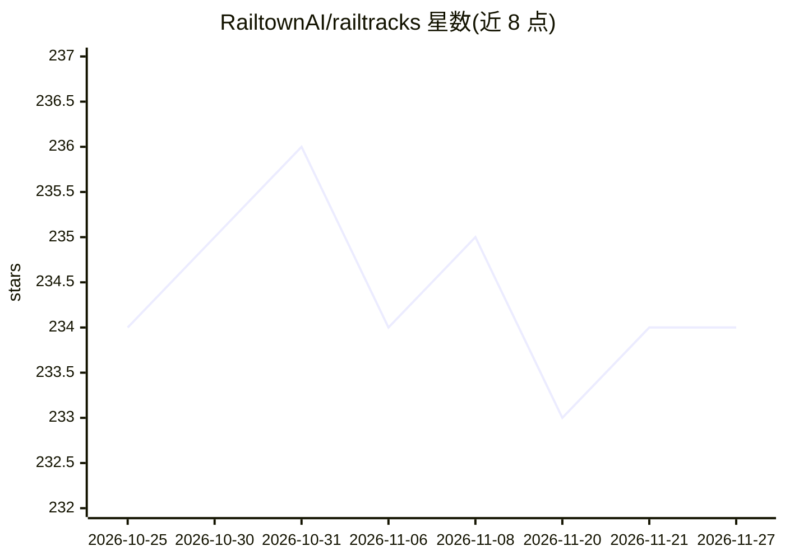

# RailtownAI/railtracks

⭐ 234 · Python · MIT · 推送 2026-11-26 · [GitHub](https://github.com/RailtownAI/railtracks) · [官网](https://docs.railtracks.org/) · 组织维护

**让开发者用纯 Python 组装 agent 框架与 harness 的库**

Railtracks 是一个 Python agent 框架，将 tool-calling 循环、工具面、上下文管理、权限与预算控制、可回放记录等组件以普通 Python 对象形式提供，由开发者自行组装，不使用 YAML 或 DSL。框架分 Loop、Tool surface、Context、Controls、Record 五个部分，附编码、研究、运维三类 harness 示例；内置本地运行的可视化观测工具与评估接口，支持 asyncio 风格调用与 MCP 协议。通过 pip 安装，API key 经 .env 文件加载。

## 筛选速览

| 维度 | 判定 | 备注 |
|---|---|---|
| AI 角色 | `ai-ecosystem` | LLM/agent 周边工具 |
| 许可风险 | `permissive` | MIT |
| 部署形态 | `library` | 以包/库形式分发 |
| 模型依赖 | — | README 未给出锁定关系 |
| 硬件要求 | — | 无带数字的原话,不猜 |
| 安装摩擦 | `low` | 无编译、无系统依赖或容器化 |
| 成熟度 | — | 结构信号不足 |

## 能力要点

- 五组件结构（Loop/工具面/Context/Controls/Record）以普通 Python 对象组装
- 本地可视化工具实时查看 agent 运行，无需注册
- rt.decision_node 以单次调用返回校准概率用于分类/路由
- 支持 MCP 协议、人工审批 verifier 与 MaxCalls/Timeout/Retry 控制项

## 适用场景

- 用纯 Python 搭建自定义 coding harness，文件写入与 shell 命令需人工审批
- 构建带检索与记忆的研究型 agent，输出限定到 schema
- 为高危运维工具加审批与审计记录

## 场景标签

`Agent 框架` `RAG` `LLM 可观测性` · 领域:Agent 开发

## 证据(README 行号)

> L26: Railtracks is a Python **agent framework** for building your own **agents and/or harness**. Every piece is an ordin
> L44: |**Loop**|When the agent keeps going, and when it's done|`rt.agent_node` runs the tool-calling loop; `rt.Flow` and 

## 星数曲线

2026-10-25 234 → 2026-11-27 234（+0）

---
*卡片 v1 · prompt 1.4 · 生成 2026-11-27 · 置信度 high · 依据 README sha `6a865bfc577e` · [字段定义](../../DATASET.md)*
