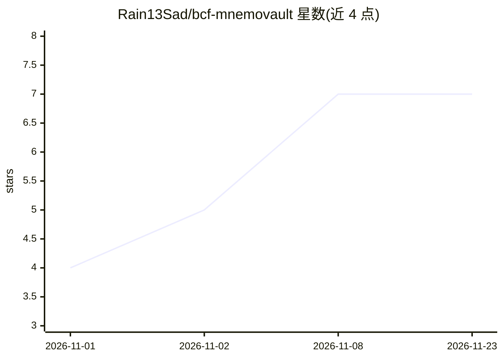

# Rain13Sad/bcf-mnemovault

⭐ 7 · TypeScript · MIT · 推送 2026-11-16 · [GitHub](https://github.com/Rain13Sad/bcf-mnemovault) · 个人维护 · 中文 README

**给 LLM 应用提供情感感知持久化记忆的插件**

面向 LLM 的记忆引擎：将记忆存为固定大小的 341 B 细胞（稀疏码、int8 向量、类型化超边、压缩残差）而非文本，通过四通道召回在每轮注入约 105–117 tokens。支持独立运行或作为插件嵌入 DeepSeek Harness，附带情感内核、命令面板、Prometheus 指标、导出/备份工具与危机干预模块。当前为 v0.7.3 Developer Preview，README 声明中文文档为准并公开 28 项已知弱点，Node 生态下除配置 schema 外无第三方运行时依赖。

## 筛选速览

| 维度 | 判定 | 备注 |
|---|---|---|
| AI 角色 | `ai-ecosystem` | LLM/agent 周边工具 |
| 许可风险 | `permissive` | MIT |
| 部署形态 | `library` | 以包/库形式分发 |
| 模型依赖 | — | README 未给出锁定关系 |
| 硬件要求 | — | 无带数字的原话,不猜 |
| 安装摩擦 | `low` | 无编译、无系统依赖或容器化 |
| 成熟度 | `idea` | |

## 能力要点

- 记忆以稀疏码/int8 向量/类型化超边存储，非文本回放
- 四通道确定性召回，每轮注入约 105–117 tokens
- 租户隔离、物理删除校验、危机四级评估与未成年人检测
- 11 个机制验证区块接入 CI 门禁，377 项测试

## 适用场景

- 给带记忆的 AI 陪伴/助手应用提供持久记忆层
- 作为 DeepSeek Harness 的插件管理对话记忆与情感状态
- 需要按用户隔离记忆、可审计删除与导出的 LLM 应用

## 场景标签

`Agent 记忆` · 领域:Agent 开发

## 证据(README 行号)

> L3:  MnemoVault — an emotion-aware memory engine for LLMs
> L6: affect kernel, 3D star map. Runs standalone, or as a plugin inside DeepSeek Harness.
> L30: |**Size**|11 packages · 79 source files / ~28,300 lines of TS (`.ts` + `.tsx`, UI included) · 377 tests · **no thir

## 星数曲线

2026-11-01 4 → 2026-11-23 7（+3）

---
*卡片 v1 · prompt 1.4 · 生成 2026-11-20 · 置信度 high · 依据 README sha `84abe05d5167` · [字段定义](../../DATASET.md)*
