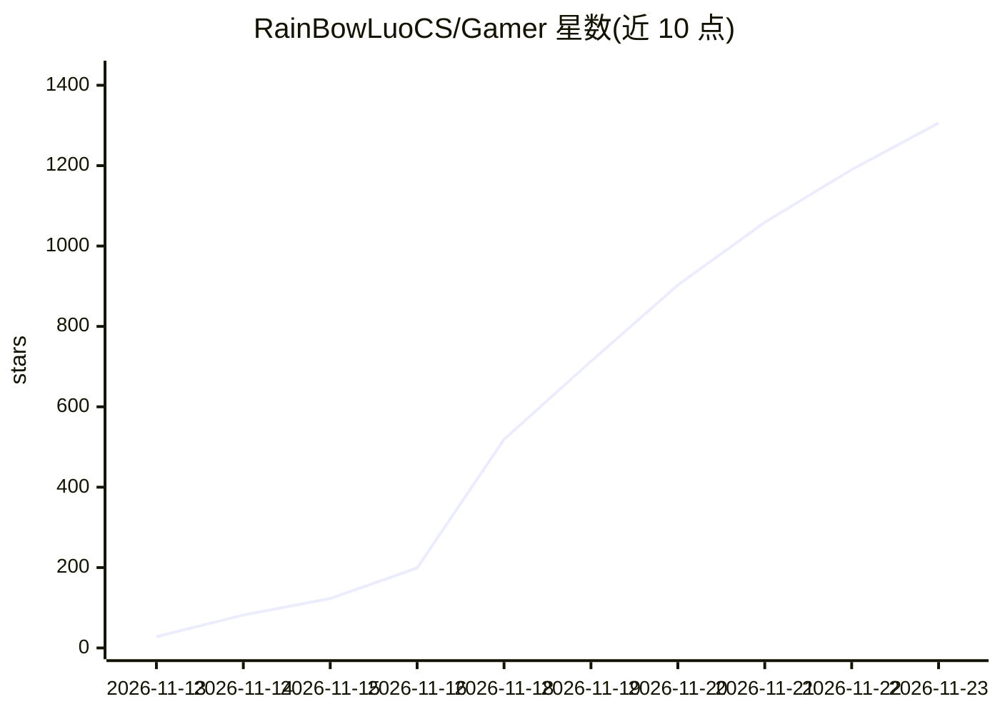

# RainBowLuoCS/Gamer

⭐ 1,306 · Apache-2.0 · 推送 2026-11-16 · [GitHub](https://github.com/RainBowLuoCS/Gamer) · [官网](https://mihoyo-gamer.github.io/) · 组织维护 · 中文 README

**通用视觉-语言-动作游戏智能体基础模型，生成键鼠操作**

miHoYo 荣耀 AI 研发团队与多所高校合作的官方实现：Gamer 通过屏幕观察、短期历史、长期记忆与推理生成跨游戏的键盘鼠标操作。训练分三阶段：数万小时设备级键鼠轨迹的继续预训练、稀疏思考指令微调、以及 Temporal-Aware GRPO 多轮强化学习。配套 Streaming-vLLM 推理引擎（README 中标注尚未发布），支持 Qwen3-VL/Qwen3.5 骨干。当前仓库主要提供系统提示词模板、动作格式（约 200ms 决策、6 步动作块、74 个键位 token）与解析规范，模型与引擎代码待放出的部分列入 TODO。

## 筛选速览

| 维度 | 判定 | 备注 |
|---|---|---|
| AI 角色 | `ai-native` | 本体是模型或模型工具 |
| 许可风险 | `permissive` | Apache-2.0 |
| 部署形态 | `None` |  |
| 模型依赖 | — | README 未给出锁定关系 |
| 硬件要求 | — | 无带数字的原话,不猜 |
| 安装摩擦 | `low` | 无编译、无系统依赖或容器化 |
| 成熟度 | — | 结构信号不足 |

## 能力要点

- 屏幕观察直接生成键盘鼠标操作的统一接口
- 三阶段训练：继续预训练 + 稀疏推理 SFT + TA-GRPO 强化学习
- 动作块格式：约 200ms 决策分 6 步，74 个大小写敏感键位 token
- Streaming-vLLM 推理引擎：KV-cache 复用、FSM 投机解码、早发动作分发（未发布）

## 适用场景

- 让智能体在 3D 开放世界游戏中执行长程任务
- 在 2D 游戏基准上运行游戏智能体
- 按给定系统提示词与动作格式部署和解析模型输出

## 场景标签

`多模态` `模型训练` `强化学习` · 领域:感知与多模态

## 证据(README 行号)

> L12:  Gamer: a generalist game agent combining screen observations, short-term history, long-term memory, and reasoning 
> L19: We introduce Gamer, a generalist agent framework built for long-horizon tasks in complex interactive environments. 

## 星数曲线

2026-11-13 28 → 2026-11-23 1,306（+1,278）

---
*卡片 v1 · prompt 1.4 · 生成 2026-11-18 · 置信度 high · 依据 README sha `d618073287e0` · [字段定义](../../DATASET.md)*
