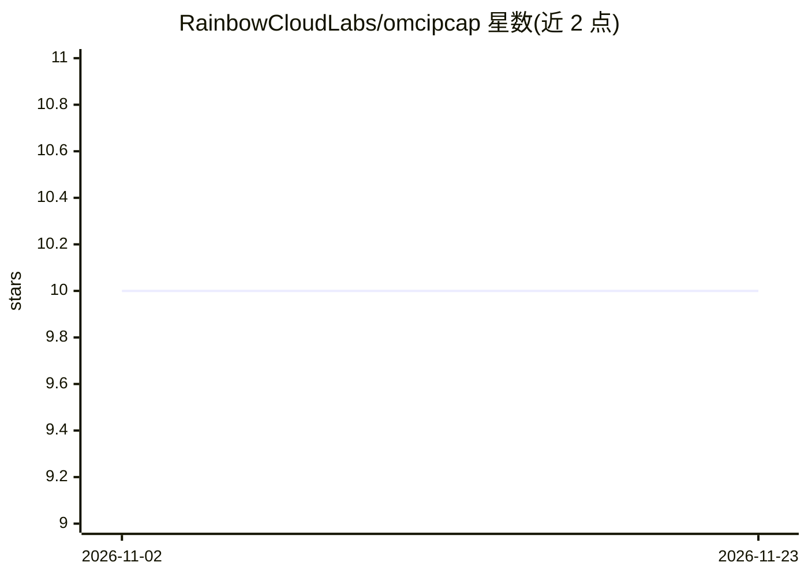

# RainbowCloudLabs/omcipcap

⭐ 10 · Python · MIT · 推送 2026-10-17 · [GitHub](https://github.com/RainbowCloudLabs/omcipcap) · 组织维护

**面向 GPON/XG-PON 工程师的 OMCI pcap 协议语义分析框架**

基于表驱动语义引擎读取 OMCI 抓包文件，输出 MIB 状态审计、VLAN 逻辑解码、T-CONT→GEM→PQ 流量层级追踪与交互式拓扑 HTML，支持 Table/Markdown/JSON 三种输出，JSON IR 面向脚本与 CI/CD。提供 pip 安装与免 Python 的三平台预编译二进制。可选 AI 功能包括基于云端或本地 LLM 的 AI Diagnosis、Target/Golden 抓包对比，以及用自有故障案例构建本地 RAG 知识库；核心协议分析功能不依赖 AI 即可运行。

## 筛选速览

| 维度 | 判定 | 备注 |
|---|---|---|
| AI 角色 | `ai-enhanced` | 去掉 AI 部分产品仍成立 |
| 许可风险 | `permissive` | MIT |
| 部署形态 | `desktop` | 安装包/桌面程序 |
| 模型依赖 | — | README 未给出锁定关系 |
| 硬件要求 | — | 无带数字的原话,不猜 |
| 安装摩擦 | `low` | 无编译、无系统依赖或容器化 |
| 成熟度 | `idea` | |

## 能力要点

- 表驱动 OMCI 语义解码：MIB 重建、mibdb-diff、VLAN 表与流量层级追踪
- 所有命令支持 JSON IR 输出，供脚本、AI 工作流与 CI/CD 集成
- 可选 AI Diagnosis 与本地 RAG 故障知识库（云端或本地 LLM）
- 支持自定义厂商 ME JSON schema 与 --semantic-dir 语义扩展，含敏感字段掩码

## 适用场景

- 分析现场采集的 OMCI pcap，定位 ONU 配置与协议错误
- 对比正常与异常设备的 MIB 差异做根因排查
- 将分析结果输出 JSON 接入自动化流水线
- 用自有故障案例搭建私有 OMCI RAG 排障知识库

## 场景标签

`RAG` · 领域:知识与检索

## 证据(README 行号)

> L8: `omcipcap` is a professional GPON/XGS-PON OMCI Semantic Analysis Framework for ITU-T G.988 protocols. By implementin
> L14: - **AI Diagnosis** — Analyze single captures or compare Target vs. Golden captures using cloud or local LLMs.
> L18: - **Optional Local RAG** — Build a private OMCI troubleshooting knowledge base using your own issue cases.

## 星数曲线

2026-11-02 10 → 2026-11-23 10（+0）

---
*卡片 v1 · prompt 1.4 · 生成 2026-11-20 · 置信度 high · 依据 README sha `1a072c26b45c` · [字段定义](../../DATASET.md)*
