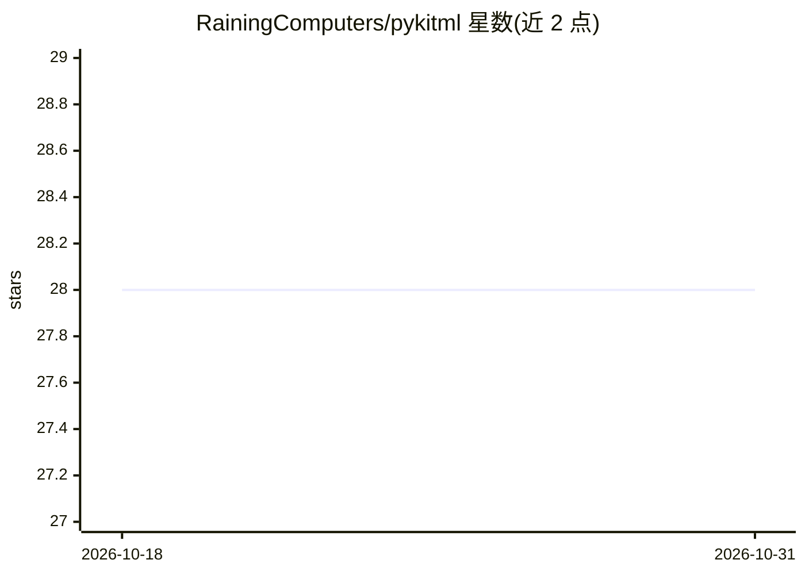

# RainingComputers/pykitml

⭐ 28 · Python · MIT · 推送 2026-02-11 · [GitHub](https://github.com/RainingComputers/pykitml) · 个人维护

**基于 Python 与 NumPy 的机器学习库**

纯 Python 与 NumPy 实现的机器学习库，主题涵盖神经网络、深度学习与随机森林等算法。以 pip 包形式发布，提供 readthedocs 在线文档，README 内含 MNIST 训练与测试示例代码，并展示性能曲线与混淆矩阵。面向需要在 NumPy 基础上直接使用或研究机器学习算法实现的开发者。

## 筛选速览

| 维度 | 判定 | 备注 |
|---|---|---|
| AI 角色 | `ai-native` | 本体是模型或模型工具 |
| 许可风险 | `permissive` | MIT |
| 部署形态 | `library` | 以包/库形式分发 |
| 模型依赖 | — | README 未给出锁定关系 |
| 硬件要求 | — | 无带数字的原话,不猜 |
| 安装摩擦 | `low` | 无编译、无系统依赖或容器化 |
| 成熟度 | — | 结构信号不足 |

## 能力要点

- 以 Python 和 NumPy 实现机器学习算法
- 覆盖神经网络、随机森林等主题
- 提供 readthedocs 文档与 MNIST 示例

## 适用场景

- 用 NumPy 实现训练与预测机器学习模型
- 学习或实验神经网络等算法实现

## 场景标签

 · 领域:机器学习/算法库

## 证据(README 行号)

> L4: Machine Learning library written in Python and NumPy.
> L17: ### Training

## 星数曲线

2026-10-18 28 → 2026-10-31 28（+0）

---
*卡片 v1 · prompt 1.4 · 生成 2026-10-26 · 置信度 high · 依据 README sha `d44d9685ca50` · [字段定义](../../DATASET.md)*
