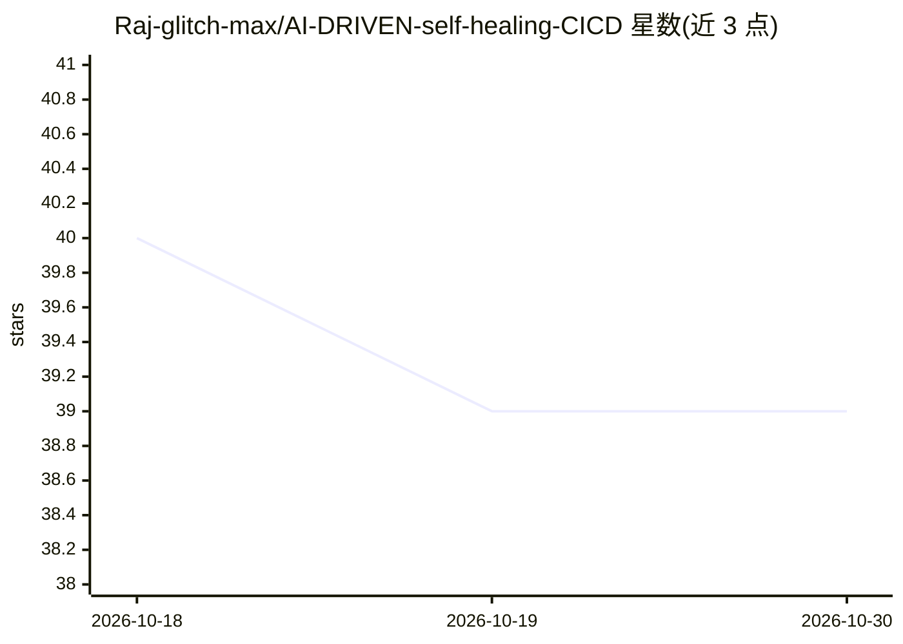

# Raj-glitch-max/AI-DRIVEN-self-healing-CICD

⭐ 39 · Python · MIT · 推送 2026-02-23 · [GitHub](https://github.com/Raj-glitch-max/AI-DRIVEN-self-healing-CICD) · 个人维护

**Jenkins 流水线中自动分析测试失败并用 GPT-4 生成修复并发 PR 的自愈 CI/CD 项目**

在 Jenkins CI 流水线中嵌入 AI Healer Agent：测试失败后解析日志（支持 pytest/unittest），调用 OpenAI GPT-4 分析错误语义与代码上下文，生成修复、创建分支提交并自动开 PR 供人工审核合并。技术栈为 Python 3.11/Flask，通过 Docker Compose 部署 Jenkins、应用与 Prometheus/Grafana 监控。需要 OpenAI API Key 与 GitHub Token，面向 DevOps 工程师演示自动化修复流程。

## 筛选速览

| 维度 | 判定 | 备注 |
|---|---|---|
| AI 角色 | `ai-native` | 本体是模型或模型工具 |
| 许可风险 | `permissive` | MIT |
| 部署形态 | `self-host` | docker 或自建部署 |
| 模型依赖 | — | README 未给出锁定关系 |
| 硬件要求 | — | 无带数字的原话,不猜 |
| 安装摩擦 | `low` | 无编译、无系统依赖或容器化 |
| 成熟度 | — | 结构信号不足 |

## 能力要点

- 测试失败后自动解析日志并由 GPT-4 生成修复
- 自动创建分支、提交并开 PR 附带错误分析
- 支持 pytest/unittest 的日志解析，复杂错误回退 LLM 分析
- Docker Compose 部署 Jenkins、应用与 Prometheus/Grafana 监控

## 适用场景

- CI 构建失败时自动生成修复 PR，缩短人工排障时间
- 在 Jenkins 流水线中加入 AI 辅助的根因分析
- 通过 Grafana/Prometheus 查看修复成功率与 MTTR 指标

## 场景标签

`编码 Agent` · 领域:编码与开发

## 证据(README 行号)

> L11: This project demonstrates a **revolutionary Self-Healing CI/CD Pipeline** that uses **Artificial Intelligence** to 
> L17: - **🔧 Autonomous Code Repair**: Generates and applies fixes automatically
> L129:  - GPT-4 analyzes the failing code and error context

## 星数曲线

2026-10-18 40 → 2026-10-30 39（-1）

---
*卡片 v1 · prompt 1.4 · 生成 2026-10-25 · 置信度 high · 依据 README sha `88cd491b5ae0` · [字段定义](../../DATASET.md)*
