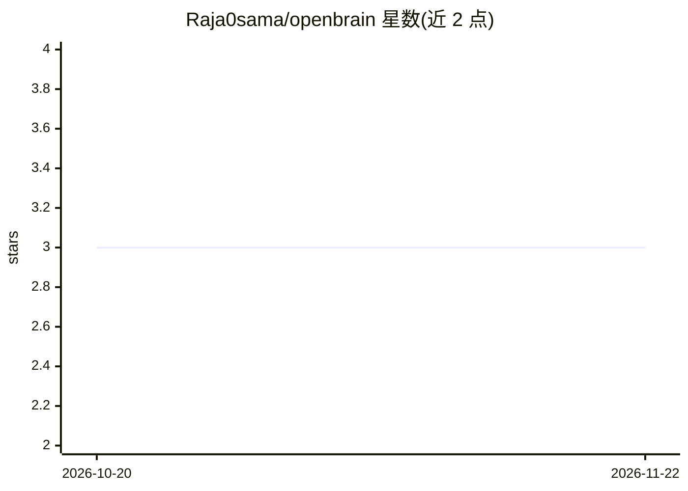

# Raja0sama/openbrain

⭐ 3 · Python · Apache-2.0 · 推送 2026-10-10 · [GitHub](https://github.com/Raja0sama/openbrain) · 个人维护

**以本地记忆图谱而非更大模型驱动的个人 AI 伴侣**

一个 Python 实现的本地 AI 系统：模型固定为小尺寸（Qwen 2.5 7B 对话、3B 判定，经 Ollama 运行），全部知识存在模型外的 SQLite 记忆图谱中，通过嵌入检索与图谱扩散激活召回，纠错会覆盖旧事实。无法自答时向教师端（Claude Code 登录或 Anthropic API）提问，每日上限 20 次，用户隐私内容经本地门控不外发。人格随交互经验形成，含锁定价值观内核。需 Ollama、uv 与约 7GB 磁盘。作者自述在数千条记忆内召回可行，超过后变慢。

## 筛选速览

| 维度 | 判定 | 备注 |
|---|---|---|
| AI 角色 | `ai-native` | 本体是模型或模型工具 |
| 许可风险 | `permissive` | Apache-2.0 |
| 部署形态 | `None` |  |
| 模型依赖 | local-ok | 支持本地模型 |
| 硬件要求 | — | 无带数字的原话,不猜 |
| 安装摩擦 | `low` | 无编译、无系统依赖或容器化 |
| 成熟度 | — | 结构信号不足 |

## 能力要点

- 知识存于 SQLite 记忆图谱，模型固定不随知识增长
- 纠错写入记忆并从此覆盖模型默认回答，未学过则标记为 not taught
- 教师机制：每日 20 次上限、全量日志、本地门控不发送用户内容
- brain bench 基准含防预训练泄露的虚构数据测试

## 适用场景

- 搭建一个随日常教导持续积累知识的本地个人 AI
- 在教学对话中训练它并随时纠正其错误认知
- 在仪表盘上观察其思考流、记忆图谱与待填补知识缺口

## 场景标签

`知识图谱` `AI 助手` · 领域:对话与助手

## 证据(README 行号)

> L5: **A brain that grows by learning, not by getting bigger.**
> L22: - **The model is fixed and small.** Qwen 2.5 7B talks. Qwen 2.5 3B judges. Both via Ollama.
> L23: - **All knowledge lives outside the model**, in a SQLite memory graph that links itself and strengthens with use.

## 星数曲线

2026-10-20 3 → 2026-11-22 3（+0）

---
*卡片 v1 · prompt 1.4 · 生成 2026-11-22 · 置信度 high · 依据 README sha `1525ce7f93d8` · [字段定义](../../DATASET.md)*
