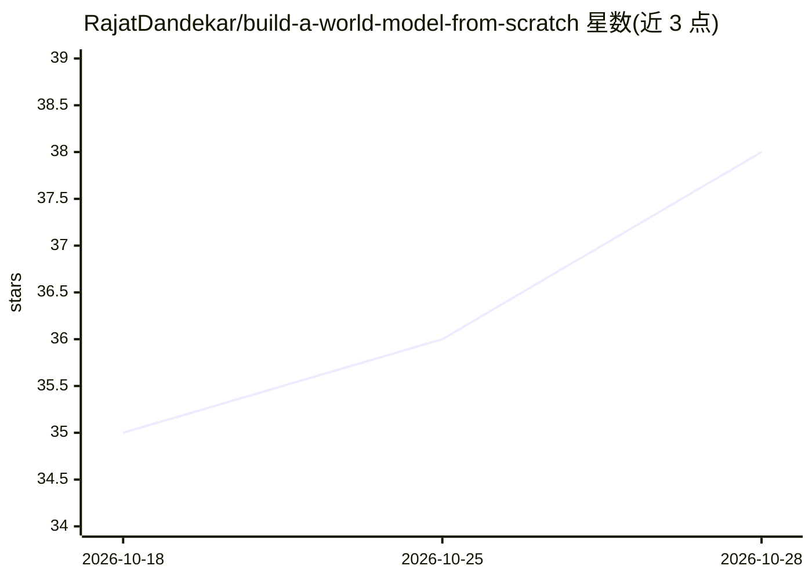

# RajatDandekar/build-a-world-model-from-scratch

⭐ 39 · Jupyter Notebook · 推送 2026-10-06 · [GitHub](https://github.com/RajatDandekar/build-a-world-model-from-scratch) · 组织维护

**世界模型从零构建讲授课件、源码与 Colab 笔记本系列**

Vizuara AI 出品的世界模型系列课程：按 0–15 讲组织，每讲含幻灯片、可运行代码与 Colab 笔记本，从编码器+记忆+预测的迷你 Pong 世界模型起步，逐步覆盖 RSSM（真实 SO-101 机器人数据）、IRIS、I-JEPA、DINO-WM、DIAMOND 扩散世界模型、V-JEPA 2、DreamZero 等主题。声称无需 GPU、每个幻灯片数字来自仓库代码输出。面向学习世界模型与强化学习的开发者和学生。

## 筛选速览

| 维度 | 判定 | 备注 |
|---|---|---|
| AI 角色 | `ai-knowledge` | 知识聚合/清单类 |
| 许可风险 | `none` | — |
| 部署形态 | `None` |  |
| 模型依赖 | — | README 未给出锁定关系 |
| 硬件要求 | — | 无带数字的原话,不猜 |
| 安装摩擦 | `low` | 无编译、无系统依赖或容器化 |
| 成熟度 | — | 结构信号不足 |

## 能力要点

- 每讲提供幻灯片+可运行代码+Colab 笔记本
- 覆盖 RSSM/IRIS/I-JEPA/DINO-WM/DIAMOND/V-JEPA 2/DreamZero 等系列实现
- 在真实 SO-101 机器人数据上训练与规划
- 声明无需 GPU，数字均为代码真实输出

## 适用场景

- 系统学习世界模型的原理与从零实现
- 跟随 Colab 笔记本复现 RSSM、I-JEPA、DINO-WM 等模型
- 了解机器人数据上的世界模型训练与规划方法

## 场景标签

`教程课程` `强化学习` · 领域:学习与行业

## 证据(README 行号)

> L5:  A lecture series by Vizuara AI — slides, runnable code, and Colab notebooks.
> L29: |#|Lecture|Materials|What you'll learn|

## 星数曲线

2026-10-18 35 → 2026-10-28 38（+3）

---
*卡片 v1 · prompt 1.4 · 生成 2026-10-25 · 置信度 high · 依据 README sha `a28ebedc4270` · [字段定义](../../DATASET.md)*
