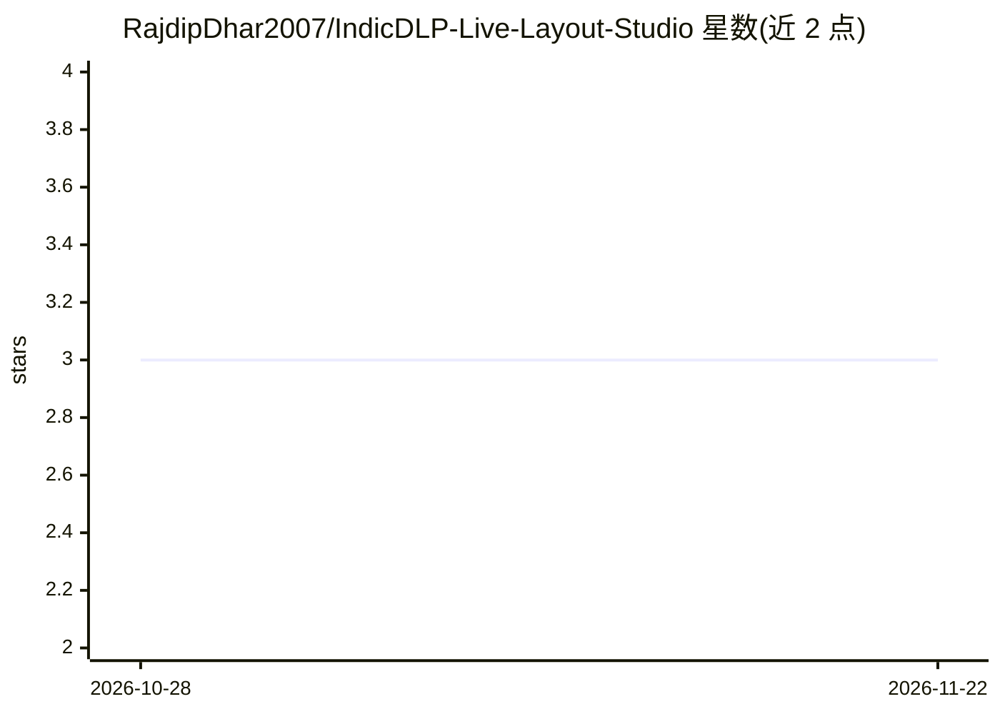

# RajdipDhar2007/IndicDLP-Live-Layout-Studio

⭐ 3 · Python · 推送 2026-11-21 · [GitHub](https://github.com/RajdipDhar2007/IndicDLP-Live-Layout-Studio) · 个人维护

**面向研究者的印度语系文档版面解析 Web 界面**

一个基于 Streamlit 的实时文档版面解析应用，将 IndicDLP 发布的两个检测器（YOLOv10x 与 DocLayout-YOLO）封装在同一界面下，通过多尺度推理与 Weighted Boxes Fusion 融合预测，支持 42 类区域名称以英语、孟加拉语等 12 种语言显示，用 Gemini 或 EasyOCR 读取区域文本，支持多页 PDF 批处理与 PNG/JSON/COCO JSON/PAGE-XML/HTML/TXT 导出。面向研究者和档案工作者，用于运行、比较和检查版面检测模型。检测器使用官方发布的 checkpoints，未从头重训。

## 筛选速览

| 维度 | 判定 | 备注 |
|---|---|---|
| AI 角色 | `ai-native` | 本体是模型或模型工具 |
| 许可风险 | `none` | — |
| 部署形态 | `None` |  |
| 模型依赖 | — | README 未给出锁定关系 |
| 硬件要求 | — | 无带数字的原话,不猜 |
| 安装摩擦 | `medium` | 含编译或系统依赖之一 |
| 成熟度 | — | 结构信号不足 |

## 能力要点

- 单一界面运行 YOLOv10x 与 DocLayout-YOLO 两个检测器并做集成融合
- 42 类区域名称支持 12 种印度语言显示，切换语言不触发重新推理
- 多页 PDF 批处理，导出 COCO JSON、PAGE-XML、HTML 等多种格式
- 递归 XY-cut 阅读顺序排序与逐区域动画展示

## 适用场景

- 将孟加拉语或英语文档页面送入界面查看各模型的检测区域
- 对扫描报纸、试卷、表格等多页 PDF 做批量版面解析与导出
- 对检测器输出进行逐类 AP 评测与人工标注对比

## 场景标签

`目标检测` `文档解析` · 领域:知识与检索

## 证据(README 行号)

> L22: This project builds a web application, the Live Layout Studio, that puts two of these detectors (YOLOv10x and DocLa
> L24: It animates detection region by region, shows the 42 class names in English, Bengali and ten other Indic languages,
> L65: To make state-of-the-art Indic layout detectors easy to run, compare and inspect, so that a researcher or archivist

## 星数曲线

2026-10-28 3 → 2026-11-22 3（+0）

---
*卡片 v1 · prompt 1.4 · 生成 2026-11-22 · 置信度 high · 依据 README sha `9560e42d4b71` · [字段定义](../../DATASET.md)*
