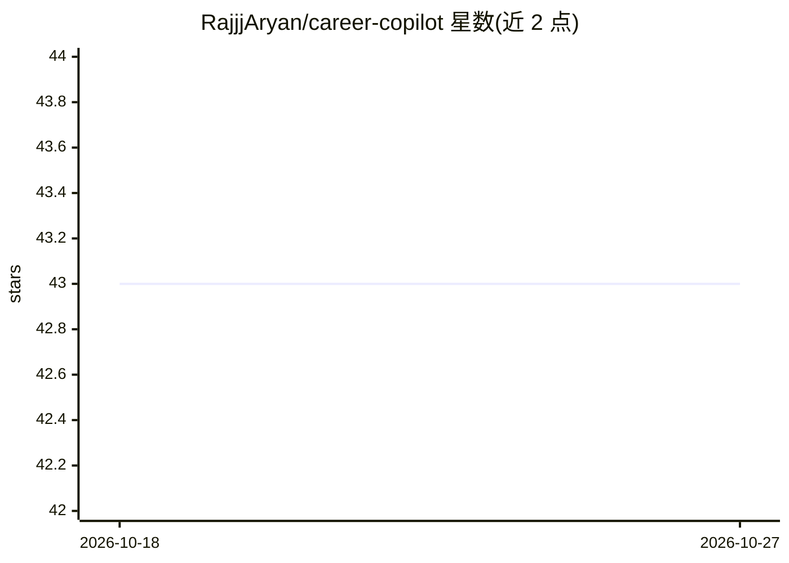

# RajjjAryan/career-copilot

⭐ 43 · JavaScript · MIT · 推送 2026-07-01 · [GitHub](https://github.com/RajjjAryan/career-copilot) · [官网](https://github.com/RajjjAryan/career-copilot) · 个人维护

**给求职者的 AI agent 驱动求职流水线：评估 offer、生成 CV、追踪申请**

一套本地运行的求职工作流项目：由 AI 编程代理（GitHub Copilot CLI、Claude Code、Gemini CLI、Cursor、Windsurf 等）读取仓库内的指令文件驱动执行。功能包括 A-F 六维加权评分评估职位、生成 ATS 优化的个性化 CV PDF、扫描 45+ 公司招聘门户（Greenhouse/Ashby/Lever/Wellfound）、RSS 职位发现、批量并行处理、STAR+Reflection 面试故事库与谈判分析。强调人工决策在环，声明不自动群投、评分低于 4.0/5 的岗位建议不申请。需要 Node.js>=18 与一个 AI 编程工具。

## 筛选速览

| 维度 | 判定 | 备注 |
|---|---|---|
| AI 角色 | `ai-native` | 本体是模型或模型工具 |
| 许可风险 | `permissive` | MIT |
| 部署形态 | `None` |  |
| 模型依赖 | — | README 未给出锁定关系 |
| 硬件要求 | — | 无带数字的原话,不猜 |
| 安装摩擦 | `low` | 无编译、无系统依赖或容器化 |
| 成熟度 | — | 结构信号不足 |

## 能力要点

- A-F 六维加权评分系统评估 job offer
- 生成关键词注入的 ATS 优化 CV PDF
- 扫描 45+ 公司职位门户与 RSS/Atom 职位发现
- 多 AI 编程工具自动检测支持（Copilot CLI/Claude Code/Gemini CLI/Cursor/Windsurf）

## 适用场景

- 粘贴职位链接获得完整评估、CV PDF 与追踪记录
- 批量扫描并评估公司招聘门户的职位
- 积累面试故事库并准备面试
- 管理求职漏斗数据与谈判流程

## 场景标签

`工作流自动化` `AI 写作` `网页抓取` · 领域:效率与自动化

## 证据(README 行号)

> L26: AI-powered job search pipeline for **AI coding agents**. Works with GitHub Copilot CLI, Claude Code, Gemini CLI, Cu
> L30: - **Evaluate** job offers with a structured A-F scoring system (6 weighted dimensions)
> L31: - **Generate** ATS-optimized, personalized CVs per job description

## 星数曲线

2026-10-18 43 → 2026-10-27 43（+0）

---
*卡片 v1 · prompt 1.4 · 生成 2026-10-25 · 置信度 mid · 依据 README sha `0fbe2b82fcdf` · [字段定义](../../DATASET.md)*
