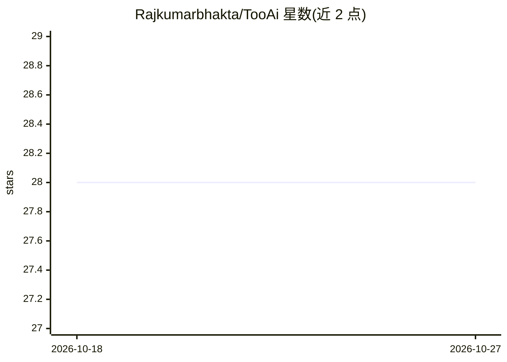

# Rajkumarbhakta/TooAi

⭐ 28 · Kotlin · MIT · 推送 2026-08-23 · [GitHub](https://github.com/Rajkumarbhakta/TooAi) · 个人维护

**离线端侧 AI 功能集合的 Android 应用**

基于 Kotlin 与 Jetpack Compose 构建的 Android 应用，离线运行多种端侧机器学习功能：通过 LiteRT-LM 运行时在设备上运行大语言模型并对话（需 Android 12+）、摄像头扫描文档、图片文字识别、条码/二维码扫描解码、图像分割抠图；识别能力来自 Google ML Kit，LLM 部分使用 Google AI Edge SDK。采用 MVVM 架构与 Repository 模式，以 Android 工程源码形式提供，README 未给出安装包下载或构建命令。所有功能无需联网即可在设备上使用。

## 筛选速览

| 维度 | 判定 | 备注 |
|---|---|---|
| AI 角色 | `ai-native` | 本体是模型或模型工具 |
| 许可风险 | `permissive` | MIT |
| 部署形态 | `None` |  |
| 模型依赖 | — | README 未给出锁定关系 |
| 硬件要求 | — | 无带数字的原话,不猜 |
| 安装摩擦 | `low` | 无编译、无系统依赖或容器化 |
| 成熟度 | — | 结构信号不足 |

## 能力要点

- 设备上离线运行 LLM 并对话（LiteRT-LM 运行时，需 Android 12+）
- 文档扫描、图片文字识别、条码/二维码扫描（ML Kit）
- 图像分割移除图片背景
- 全部功能离线在设备上运行

## 适用场景

- 在没有网络的设备上与本地大语言模型对话
- 扫描纸质文档并提取图片中的文字
- 扫描和解码条码与二维码
- 对图片做背景移除的图像分割

## 场景标签

`聊天机器人` `OCR` `目标检测` · 领域:对话与助手

## 证据(README 行号)

> L7: - **Run LLM models on device**: Chat offline with large language models (Requires Android 12+).
> L9: - **Text Recognition**: Extract text from images.
> L35: - Google AI Edge SDK : Tools to build and deploy on-device machine learning.

## 星数曲线

2026-10-18 28 → 2026-10-27 28（+0）

---
*卡片 v1 · prompt 1.4 · 生成 2026-10-26 · 置信度 high · 依据 README sha `a4ae762ca78e` · [字段定义](../../DATASET.md)*
