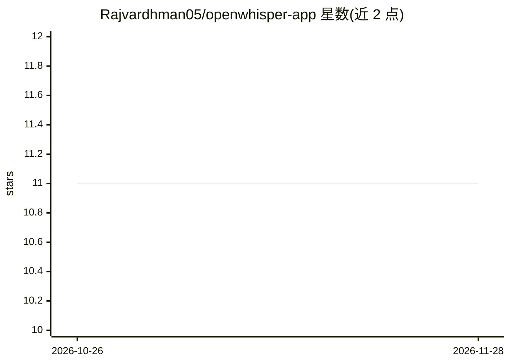

# Rajvardhman05/openwhisper-app

⭐ 11 · Swift · MIT · 推送 2026-11-15 · [GitHub](https://github.com/Rajvardhman05/openwhisper-app) · [官网](https://rajvardhman05.github.io/openwhisper-app/) · 个人维护

**macOS 本地离线语音转文字应用：按键说话即出文本**

基于 WhisperKit（OpenAI Whisper 的 Apple Silicon CoreML 实现）的 macOS 菜单栏听写应用，按住右 Option 说话、松开后文本自动粘贴到光标处，全部推理在设备本地完成。支持 hold-to-talk 与 hands-free 两种录音模式、4 档模型（tiny/base/small/small.en）、29 种语言与自动检测。可选通过本机 Ollama 运行 qwen2.5:3b 做语法清理与填充词删除，Ollama 未运行时回退为原始转录。要求 macOS 14+ 与 Apple Silicon，需授予麦克风与辅助功能权限，首次启动从 HuggingFace 下载模型。

## 筛选速览

| 维度 | 判定 | 备注 |
|---|---|---|
| AI 角色 | `ai-native` | 本体是模型或模型工具 |
| 许可风险 | `permissive` | MIT |
| 部署形态 | `None` |  |
| 模型依赖 | local-ok | 支持本地模型 |
| 硬件要求 | — | 无带数字的原话,不猜 |
| 安装摩擦 | `low` | 无编译、无系统依赖或容器化 |
| 成熟度 | — | 结构信号不足 |

## 能力要点

- WhisperKit 本地转录，全程离线，仅首次从 HuggingFace 下载模型
- 可选本地 LLM（Ollama + qwen2.5:3b）做语法清理与填充词删除
- hold-to-talk 与 hands-free（Space 锁定）两种录音模式
- 4 档 Whisper 模型可选，支持 29 种语言

## 适用场景

- 在任意应用里按住快捷键语音输入文字
- 无网络环境下进行语音转写
- 用本地 LLM 把口述内容清理成规范书面文本

## 场景标签

`语音识别` · 领域:感知与多模态

## 证据(README 行号)

> L5: OpenWhisper is a free dictation app for macOS that transcribes speech to text entirely on your Mac using WhisperKit 
> L37: - **Apple Silicon** Mac (M1, M2, M3, M4) — required for WhisperKit CoreML acceleration
> L85: 4. **Release Option** (hold mode) or **tap Space** (hands-free) → audio transcribed by on-device Whisper model

## 星数曲线

2026-10-26 11 → 2026-11-28 11（+0）

---
*卡片 v1 · prompt 1.4 · 生成 2026-11-19 · 置信度 high · 依据 README sha `ad53e7711f00` · [字段定义](../../DATASET.md)*
