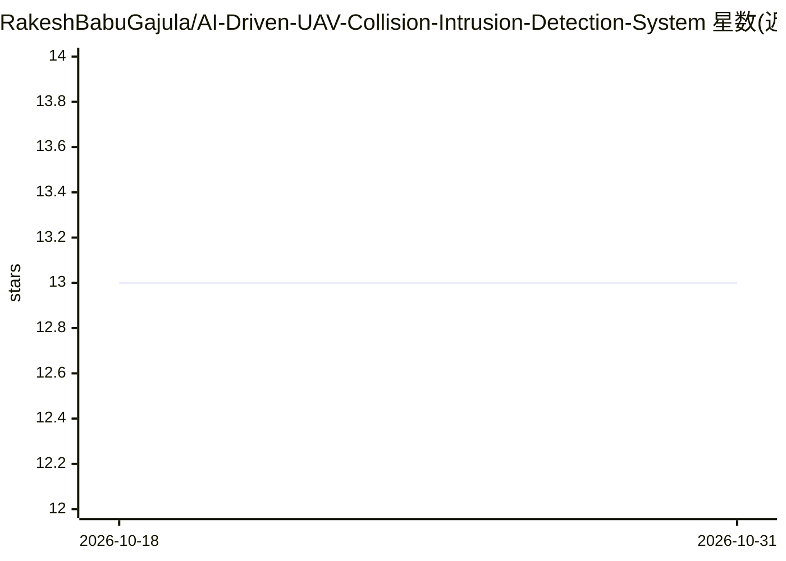

# RakeshBabuGajula/AI-Driven-UAV-Collision-Intrusion-Detection-System

⭐ 13 · Python · MIT · 推送 2026-10-16 · [GitHub](https://github.com/RakeshBabuGajula/AI-Driven-UAV-Collision-Intrusion-Detection-System) · 个人维护

**无人机碰撞与侵入检测系统：视觉检测+轨迹预测+地理围栏**

面向低空无人机运行安全（UTM）的端到端检测系统：用 YOLOv8 对视频流做实时空中目标检测，用 3D 最近接近点（CPA）运动学解析计算 t_ca 与最小间隔距离以预测碰撞风险，用 Shapely 点在多边形内算法执行禁飞区地理围栏侵入判定，并通过 Streamlit 仪表盘实时展示告警与航线可视化。以 Python 脚本集形式提供，从源码运行，支持可选 CUDA 加速推理，事件以 JSONL 日志留存。

## 筛选速览

| 维度 | 判定 | 备注 |
|---|---|---|
| AI 角色 | `ai-native` | 本体是模型或模型工具 |
| 许可风险 | `permissive` | MIT |
| 部署形态 | `library` | 以包/库形式分发 |
| 模型依赖 | — | README 未给出锁定关系 |
| 硬件要求 | — | 无带数字的原话,不猜 |
| 安装摩擦 | `low` | 无编译、无系统依赖或容器化 |
| 成熟度 | — | 结构信号不足 |

## 能力要点

- YOLOv8 实时视频目标检测
- 3D CPA 解析式碰撞预测（t_ca 与 d_min）
- Shapely 地理围栏点在多边形内侵入判定
- Streamlit 实时任务控制台与 JSONL 事件日志

## 适用场景

- 监测视频流中的空中目标与入侵飞行器
- 预测两条无人机航线的最小间隔并提前告警
- 划定禁飞区多边形并检测侵入事件
- 实时查看碰撞告警与侵入频次仪表盘

## 场景标签

`目标检测` · 领域:感知与多模态

## 证据(README 行号)

> L22: The **AI-Driven UAV Collision & Intrusion Detection System** is an end-to-end, edge-ready UTM solution engineered t
> L28: |**Vision-Based Aerial Perception**|YOLOv8 Deep Convolutional Neural Network|Real-time aerial object & intruder det

## 星数曲线

2026-10-18 13 → 2026-10-31 13（+0）

---
*卡片 v1 · prompt 1.4 · 生成 2026-10-31 · 置信度 mid · 依据 README sha `9449715da41f` · [字段定义](../../DATASET.md)*
