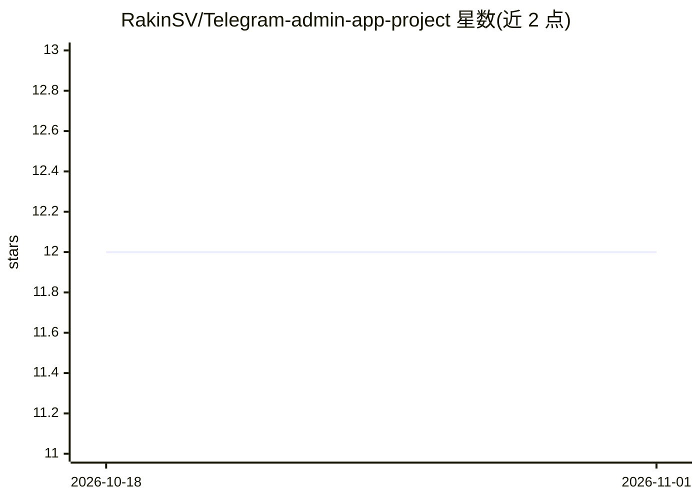

# RakinSV/Telegram-admin-app-project

⭐ 12 · Python · 推送 2026-08-24 · [GitHub](https://github.com/RakinSV/Telegram-admin-app-project) · 个人维护

**自托管 Telegram 自动化三机器人栈：AI 改写、群组治理、互动运营**

一个仓库内含三个独立 Telegram 机器人与统一 Web 管理面板：Repost 机器人经 Telethon 用户会话读取频道/RSS，走 journalist→editor 双 agent 编辑流程改写并事实核查（可配置轮数，1-10 次 LLM 调用/帖），支持语义去重、故事聚类、来源补充；Guardian 基于 aiogram 做入群验证、三模式垃圾过滤（关键词/AI/混合）、anti-raid 与警告体系；Engage 提供帖子生成测验、反欺诈推荐与可验证抽奖。Docker 打包部署，含 Alembic 迁移与 2226 个测试。

## 筛选速览

| 维度 | 判定 | 备注 |
|---|---|---|
| AI 角色 | `ai-enhanced` | 去掉 AI 部分产品仍成立 |
| 许可风险 | `none` | — |
| 部署形态 | `self-host` | docker 或自建部署 |
| 模型依赖 | local-ok | 支持本地模型 |
| 硬件要求 | — | 无带数字的原话,不猜 |
| 安装摩擦 | `low` | 无编译、无系统依赖或容器化 |
| 成熟度 | — | 结构信号不足 |

## 能力要点

- journalist+editor 双 agent 编辑流程，编辑注记附着于具体声明并存档展示
- Guardian 三模式垃圾过滤，AI 分类器 fail-open 策略
- Telethon 用户会话读取频道、多会话轮换与统一代理支持
- 两个 agent 的编辑争论可实时流式输出到 Telegram 聊天（三种详略模式）

## 适用场景

- Telegram 频道主自动改写并核实来源帖子后发布
- 社群防垃圾、防机器人与 anti-raid 管理
- 用帖子自动生成测验、做带反欺诈的推荐与抽奖运营

## 场景标签

`多智能体` `AI 写作` · 领域:Agent 开发

## 证据(README 行号)

> L12: **An automated Telegram repost bot with a two-agent AI editorial desk: scrape → rewrite & fact-check → moderate → p
> L211: |`keywords`|Stop-word list with anti-evasion normalization (homoglyphs, zero-width characters, separators)|Zero co
> L43: All three are production-ready: Alembic migrations from day one, 2226 tests,

## 星数曲线

2026-10-18 12 → 2026-11-01 12（+0）

---
*卡片 v1 · prompt 1.4 · 生成 2026-11-01 · 置信度 mid · 依据 README sha `65867fdb580f` · [字段定义](../../DATASET.md)*
