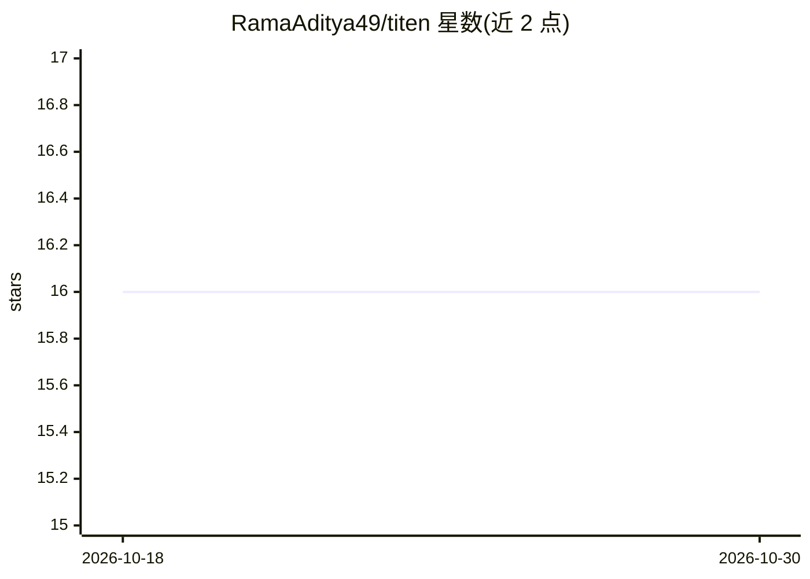

# RamaAditya49/titen

⭐ 16 · TypeScript · Apache-2.0 · 推送 2026-10-28 · [GitHub](https://github.com/RamaAditya49/titen) · [官网](https://titen.dev) · 个人维护

**自托管 agent 记忆库：无 API key、无 LLM，MCP/SQLite 本地运行**

面向 agent 开发者的自托管记忆存储：以 Bun + 单个 SQLite 文件运行，通过 MCP（stdio/Streamable HTTP）、REST 或 TypeScript SDK 接入，默认用 FTS5 词法检索，无需 LLM、嵌入提供商或 API key。每条记忆保留来源、作者与作用域，读取前做组织/主体/项目级授权过滤，矛盾证据被保留并标记。兼容 @modelcontextprotocol/server-memory 的九个工具名并可导入其存量数据；附带 audit 命令可审计 Titen、参考服务器及 Mem0 导出的存储，报告重复、召回循环、密钥模式与陈旧项。模型辅助派生功能已实现但激活门槛未达标（65.56% 对 90% 阈值）。

## 筛选速览

| 维度 | 判定 | 备注 |
|---|---|---|
| AI 角色 | `ai-ecosystem` | LLM/agent 周边工具 |
| 许可风险 | `permissive` | Apache-2.0 |
| 部署形态 | `library` | 以包/库形式分发 |
| 模型依赖 | — | README 未给出锁定关系 |
| 硬件要求 | — | 无带数字的原话,不猜 |
| 安装摩擦 | `low` | 无编译、无系统依赖或容器化 |
| 成熟度 | — | 结构信号不足 |

## 能力要点

- 零运行时依赖，仅需 Bun 1.2+ 与一个 SQLite 文件，无外呼网络
- 默认 FTS5 检索，嵌入与模型增强为可选投影
- 每条声明带作者、来源与作用域，读取前执行授权过滤，矛盾证据保留并标记
- titen audit 可审计参考服务器 memory.json、Mem0 导出与 Titen 存储

## 适用场景

- 为 MCP agent（如 Claude Code）提供无需外部服务的本地记忆存储
- 替换 @modelcontextprotocol/server-memory 并导入现有 memory.json
- 审计任意 agent 记忆存储中的重复、召回循环与陈旧条目

## 场景标签

`Agent 记忆` · 领域:Agent 开发

## 证据(README 行号)

> L3:  Agent memory that runs with no API key, no LLM, and no embedding provider.
> L35: With no environment set, that opens or creates `~/.titen/memory.db`, writes a
> L79: - **Drop-in for `@modelcontextprotocol/server-memory`.** Nineteen tools — the

## 星数曲线

2026-10-18 16 → 2026-10-30 16（+0）

---
*卡片 v1 · prompt 1.4 · 生成 2026-10-30 · 置信度 mid · 依据 README sha `3fb1f2719219` · [字段定义](../../DATASET.md)*
