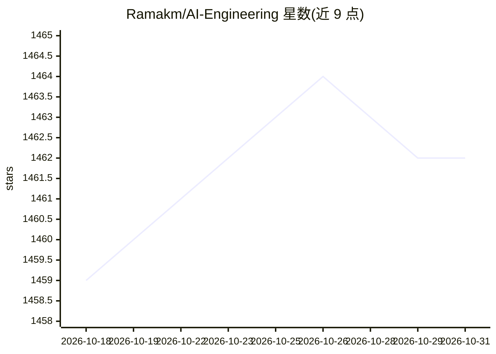

# Ramakm/AI-Engineering

⭐ 1,462 · Jupyter Notebook · MIT · 推送 2026-10-03 · [GitHub](https://github.com/Ramakm/AI-Engineering) · [官网](https://growtechie.substack.com/) · 个人维护

**AI 工程动手学习仓库：从数学到 RAG/OCR 的成套教程**

以 Jupyter notebook 为主的 AI 工程学习资源库，按学习路径组织：数学基础、PyTorch 张量操作、从零构建神经网络（含 RMSNorm、Adam/Muon 优化器）、Transformer 注意力机制、FAISS RAG 流水线、OCR 服务，另含 LLM 微调（LoRA/QLoRA/Unsloth）、经典 ML、深度学习项目与 YouTube 转录 MCP 服务器等模块。RAG 项目支持接入 Atlas Cloud（默认 DeepSeek-V3）、MiniMax、OpenAI 或任意 OpenAI 兼容 API。通过 pip 安装依赖后用 Jupyter 逐目录学习。

## 筛选速览

| 维度 | 判定 | 备注 |
|---|---|---|
| AI 角色 | `ai-knowledge` | 知识聚合/清单类 |
| 许可风险 | `permissive` | MIT |
| 部署形态 | `library` | 以包/库形式分发 |
| 模型依赖 | — | README 未给出锁定关系 |
| 硬件要求 | — | 无带数字的原话,不猜 |
| 安装摩擦 | `low` | 无编译、无系统依赖或容器化 |
| 成熟度 | — | 结构信号不足 |

## 能力要点

- 从零实现神经网络与 decoder-only Transformer 的成套 notebook
- FAISS RAG 流水线项目，LLM 提供方可插拔
- OCR 服务项目含图像预处理与 Render 部署
- 微调、经典 ML、EDA、MCP 服务器等附加模块

## 适用场景

- 系统自学 AI 工程，从数学一路学到 LLM 系统
- 动手复现 Transformer、RAG、OCR 等典型项目
- 查阅 AI/ML 推荐书籍与 GenAI 参考资料

## 场景标签

`教程课程` · 领域:学习与行业

## 证据(README 行号)

> L10: A complete, hands-on guide to becoming an AI Engineer.
> L12: This repository is designed to help you learn AI from first principles, build real neural networks, and understand 
> L45: ### 5. Retrieval-Augmented Generation (RAG)

## 星数曲线

2026-10-18 1,459 → 2026-10-31 1,462（+3）

---
*卡片 v1 · prompt 1.4 · 生成 2026-10-21 · 置信度 high · 依据 README sha `aaa810e4d718` · [字段定义](../../DATASET.md)*
