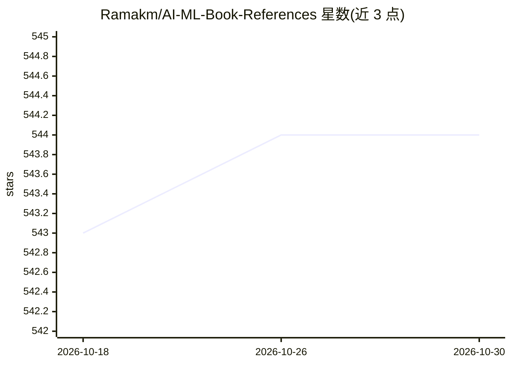

# Ramakm/AI-ML-Book-References

⭐ 544 · MIT · 推送 2026-01-16 · [GitHub](https://github.com/Ramakm/AI-ML-Book-References) · [官网](https://growtechie.substack.com/) · 个人维护

**面向各阶段学习者的 AI/ML 书籍参考清单（33 条）**

由个人维护的策展清单仓库，收录 33 本 AI、机器学习、深度学习、数据科学相关书籍，每条含书名、作者、主题领域、关键聚焦点、难度级别与 PDF 链接（部分标注 Coming Soon）。覆盖从入门到进阶的学习路径建议，并按初学者/中级/高级给出推荐顺序。仓库仅含 README 与 LICENSE，无代码或安装步骤，MIT 许可。

## 筛选速览

| 维度 | 判定 | 备注 |
|---|---|---|
| AI 角色 | `ai-knowledge` | 知识聚合/清单类 |
| 许可风险 | `permissive` | MIT |
| 部署形态 | `None` |  |
| 模型依赖 | — | README 未给出锁定关系 |
| 硬件要求 | — | 无带数字的原话,不猜 |
| 安装摩擦 | `low` | 无编译、无系统依赖或容器化 |
| 成熟度 | — | 结构信号不足 |

## 能力要点

- 33 本书籍条目，含主题、难度与链接字段
- 按初学者/中级/高级划分学习路径
- 覆盖 ML 生产系统、深度学习、数据科学、图机器学习等主题

## 适用场景

- 按难度级别挑选 AI/ML 入门与进阶书籍
- 查找特定主题（如生产级 ML、计算机视觉）的参考书
- 规划从基础到进阶的自学路径

## 场景标签

`精选清单` · 领域:学习与行业

## 证据(README 行号)

> L24: A curated and structured collection of **essential AI & Machine Learning books** for practitioners, researchers, an
> L30: This repository serves as a **knowledge hub** for Artificial Intelligence, Machine Learning, Deep Learning, Data Sc

## 星数曲线

2026-10-18 543 → 2026-10-30 544（+1）

---
*卡片 v1 · prompt 1.4 · 生成 2026-10-21 · 置信度 high · 依据 README sha `1c41d1bf6466` · [字段定义](../../DATASET.md)*
