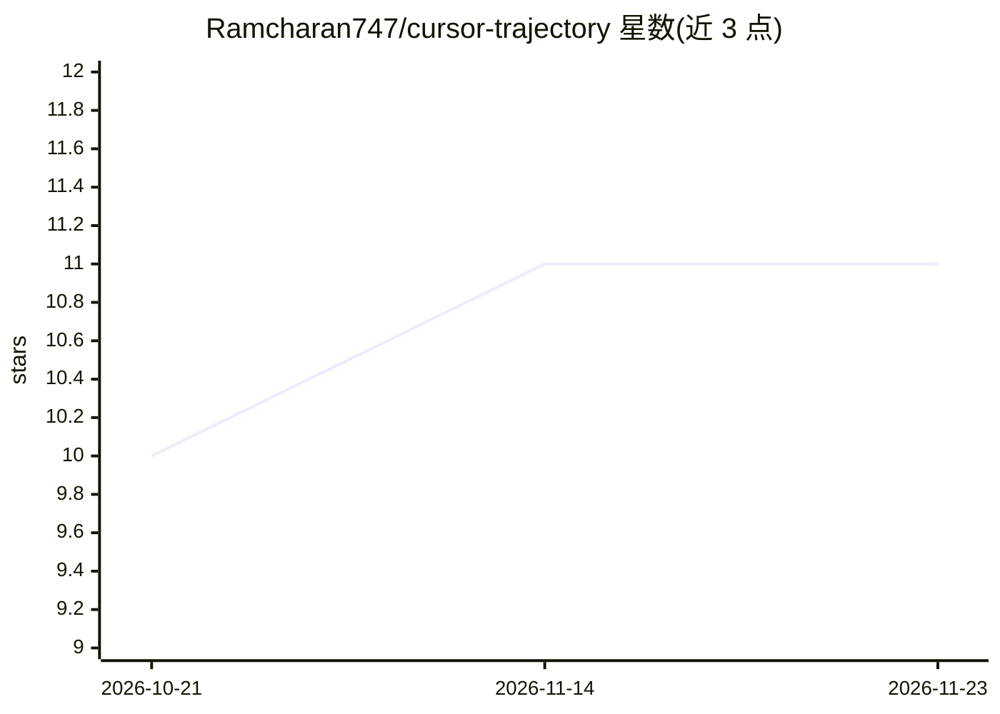

# Ramcharan747/cursor-trajectory

⭐ 11 · Python · MIT · 推送 2026-06-04 · [GitHub](https://github.com/Ramcharan747/cursor-trajectory) · [官网](https://github.com/Ramcharan747/UltraSearch) · 个人维护

**生成拟人鼠标轨迹的深度学习引擎，用于绕过行为反机器人检测**

以 PyTorch 实现的鼠标轨迹生成引擎，提供三种生成模型：基于 ODE-RNN 编码器与 dopri5 求解器的 Latent ODE、条件变分自编码器（CVAE）、带 1D U-Net 的 DDPM 扩散模型，并附带 O(1) 仿射变换求解器将生成路径适配任意起止坐标。数据采集端用 Rust 守护进程以 60Hz 记录 HID 坐标生成 JSONL 数据集。运行需 Python 3.10+ 与 CUDA 或 Apple Silicon Metal 环境。README 声明仅用于教育、研究与安全审计用途。

## 筛选速览

| 维度 | 判定 | 备注 |
|---|---|---|
| AI 角色 | `ai-native` | 本体是模型或模型工具 |
| 许可风险 | `permissive` | MIT |
| 部署形态 | `library` | 以包/库形式分发 |
| 模型依赖 | — | README 未给出锁定关系 |
| 硬件要求 | — | 无带数字的原话,不猜 |
| 安装摩擦 | `medium` | 含编译或系统依赖之一 |
| 成熟度 | — | 结构信号不足 |

## 能力要点

- 三种生成模型：Neural ODE、CVAE、DDPM，附模型对比矩阵
- Rust 守护进程以 60Hz 采集 OS 级鼠标数据构建训练集
- 零延迟仿射变换求解器（warp_trajectory）适配起止坐标
- MIT 许可，提供训练与推理的命令行流程

## 适用场景

- 研究行为反机器人检测机制的特征与局限
- 安全审计时测试自有系统的行为分析能力
- 人机交互研究中建模人类指针运动动力学

## 场景标签

`网络安全` · 领域:学习与行业

## 证据(README 行号)

> L14: The **Human Mouse Trajectory ML Engine** (v2.01) is a state-of-the-art deep learning research and implementation fr
> L66: ### 1. Latent Ordinary Differential Equations (`latent_ode.py`)
> L137: This repository is created solely for **educational, research, and security auditing purposes**. It is designed to

## 星数曲线

2026-10-21 10 → 2026-11-23 11（+1）

---
*卡片 v1 · prompt 1.4 · 生成 2026-11-18 · 置信度 high · 依据 README sha `70c4b4b779f8` · [字段定义](../../DATASET.md)*
