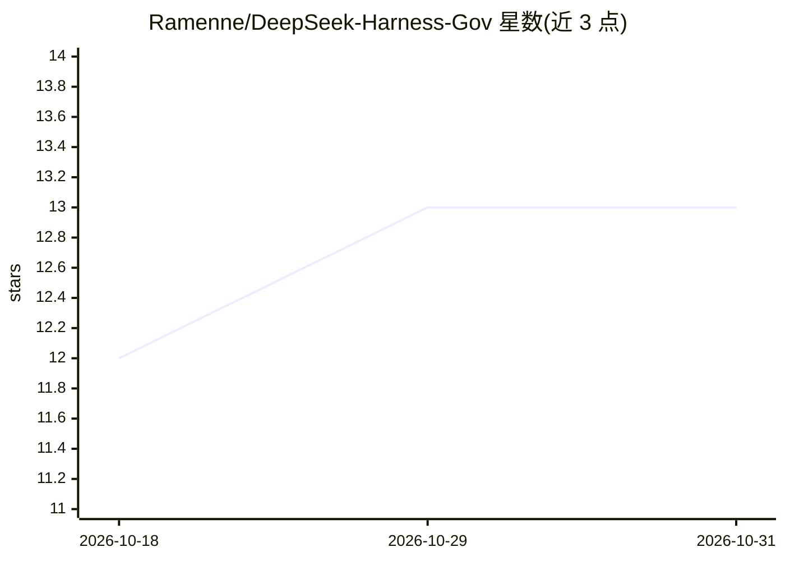

# Ramenne/DeepSeek-Harness-Gov

⭐ 13 · JavaScript · MIT · 推送 2026-08-28 · [GitHub](https://github.com/Ramenne/DeepSeek-Harness-Gov) · [官网](http://ff.urmpgo.cn) · 个人维护 · 中文 README

**政务办公 WebUI 与红头公文插件包，挂载于 DeepSeek Harness**

基于上游 DeepSeek Harness 插件体系的社区插件包，含两个插件：dsh-gov-portal 提供政务门户风格 WebUI（会话、流式回执、电子卷宗、督办流水、检索导出，通过宿主 apiProxy 接入）；dsh-tool-hongtou 以 DSH 会话命令 /hongtou 将会话整理为结构化提纲，再用确定性 Word 2003 XML 模板生成红头公文，模型不可用时回退确定性提炼。需先有可运行的 DSH 环境与模型凭据，按 Node.js ≥22.19 开发，默认仅监听本机 3081 端口，声明非 DeepSeek 官方且生成内容须经人工复核。

## 筛选速览

| 维度 | 判定 | 备注 |
|---|---|---|
| AI 角色 | `ai-ecosystem` | LLM/agent 周边工具 |
| 许可风险 | `permissive` | MIT |
| 部署形态 | `None` |  |
| 模型依赖 | — | README 未给出锁定关系 |
| 硬件要求 | — | 无带数字的原话,不猜 |
| 安装摩擦 | `low` | 无编译、无系统依赖或容器化 |
| 成熟度 | — | 结构信号不足 |

## 能力要点

- 政务门户 WebUI 通过宿主 apiProxy 接入会话、模型、权限、审批与统计能力
- 红头公文两阶段生成：模型 JSON 提纲 + 确定性 Word 2003 XML 模板注入
- 生成前执行 schema、占位符、Markdown 残留与 XML 合规检查
- 提供本地冒烟测试与 node --test 测试套件

## 适用场景

- 机关办公场景中在 DSH 会话里生成红头公文初稿
- 为 DeepSeek Harness 搭配政务风格的办事门户界面
- 查看会话事件流、电子卷宗与督办流水并导出 JSONL

## 场景标签

`AI 写作` · 领域:内容生成

## 证据(README 行号)

> L40: 本仓库基于上游 DeepSeek Harness 的插件机制，把两个互补的 DSH 插件放在同一套可安装、可验证的开源目录中：
> L47: 它不是 DeepSeek Harness 的完整发行版，也不替代 DSH 本体。你需要先有可运行的 DSH 环境，再把这两个插件挂载到 `web` profile。

## 星数曲线

2026-10-18 12 → 2026-10-31 13（+1）

---
*卡片 v1 · prompt 1.4 · 生成 2026-10-31 · 置信度 high · 依据 README sha `4074162b6336` · [字段定义](../../DATASET.md)*
