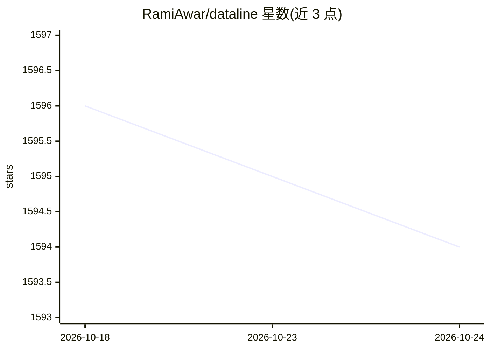

# RamiAwar/dataline

⭐ 1,593 · TypeScript · GPL-3.0 · 推送 2026-02-11 · [GitHub](https://github.com/RamiAwar/dataline) · [官网](https://dataline.app) · 组织维护

**用自然语言对话分析数据并生成图表的自托管工具**

DataLine 是 AI 驱动的数据分析与可视化工具：连接 Postgres、MySQL、Snowflake、SQLite、Excel、CSV、sas7bdat 等数据源，通过自然语言生成并执行 SQL、绘制图表，结果可修改、保存并复制用于报表。数据默认存储在本机设备，默认对所用 LLM 隐藏数据内容，可关闭该行为。架构为 Python FastAPI 后端加 React 前端，提供二进制、Homebrew 与官方 Docker 镜像三种部署方式，自托管模式支持基础认证（单用户），二进制运行不支持认证。

## 筛选速览

| 维度 | 判定 | 备注 |
|---|---|---|
| AI 角色 | `ai-native` | 本体是模型或模型工具 |
| 许可风险 | `viral` | GPL-3.0 |
| 部署形态 | `desktop` | 安装包/桌面程序 |
| 模型依赖 | — | README 未给出锁定关系 |
| 硬件要求 | — | 无带数字的原话,不猜 |
| 安装摩擦 | `low` | 无编译、无系统依赖或容器化 |
| 成熟度 | — | 结构信号不足 |

## 能力要点

- 自然语言生成并执行 SQL，可修改保存后重跑
- 支持 Postgres/Snowflake/MySQL/Excel/CSV/SQLite 等多种数据源
- 本地存储、默认对 LLM 隐藏数据内容（可关闭）
- Docker 自托管模式支持基础认证与 CORS 配置

## 适用场景

- 不写 SQL 直接用对话探索数据库或 CSV 数据
- 快速生成图表并复制到报表中
- 企业内自托管部署，用账号密码保护数据分析服务

## 场景标签

`数据分析` · 领域:效率与自动化

## 证据(README 行号)

> L29: DataLine is an AI-driven data analysis and visualization tool.
> L48: - [x] Generating and executing SQL from natural language

## 星数曲线

2026-10-18 1,596 → 2026-10-24 1,594（-2）

---
*卡片 v1 · prompt 1.4 · 生成 2026-10-21 · 置信度 high · 依据 README sha `09861eb616ad` · [字段定义](../../DATASET.md)*
