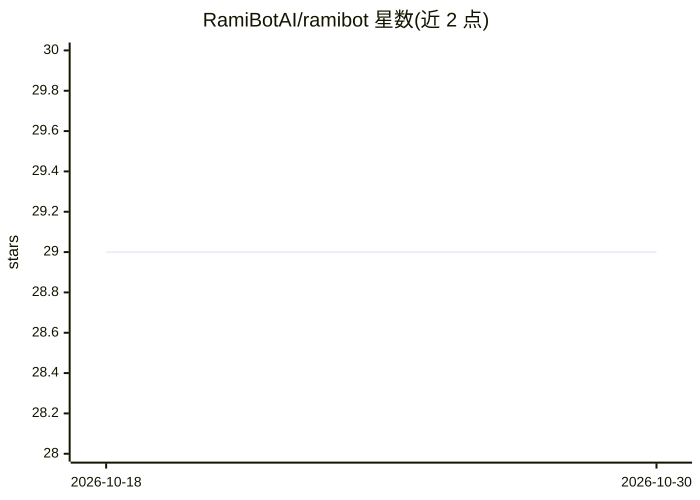

# RamiBotAI/ramibot

⭐ 29 · Python · MIT · 推送 2026-03-22 · [GitHub](https://github.com/RamiBotAI/ramibot) · [官网](https://RamiBot.com) · 个人维护

**本地优先的 AI 安全运维聊天平台：多 LLM 接入红蓝队工具链**

面向安全工程师的自托管聊天应用：将 OpenAI、Anthropic、OpenRouter、LM Studio、Ollama 等多 LLM 提供商与 MCP 工具编排连接，通过技能管线按侦察/利用/防御/报告等阶段注入结构化方法论提示，红/蓝队模式控制可用技能。集成 rami-kali MCP 服务器（45+ 渗透测试工具）、Docker 终端、Tor 代理管理、人工审批门（工具调用前暂停确认）与证据锁定报告（防止编造 CVE/版本）。对话存于本地 SQLite，工具执行均在 Docker 容器内。要求 Python 3.9+、Node.js 18+ 与 Docker Desktop。

## 筛选速览

| 维度 | 判定 | 备注 |
|---|---|---|
| AI 角色 | `ai-native` | 本体是模型或模型工具 |
| 许可风险 | `permissive` | MIT |
| 部署形态 | `desktop` | 安装包/桌面程序 |
| 模型依赖 | local-ok | 支持本地模型 |
| 硬件要求 | — | 无带数字的原话,不猜 |
| 安装摩擦 | `low` | 无编译、无系统依赖或容器化 |
| 成熟度 | — | 结构信号不足 |

## 能力要点

- 技能管线按操作阶段分类输入并注入结构化提示（recon/exploit/defense/reporting 等 7 类技能）
- rami-kali MCP 服务器向 LLM 提供 45+ 渗透测试工具
- 工具审批门：每次 MCP 工具调用前人工确认，超时自动拒绝
- 证据锁定报告：工具结果以不可变证据块包裹，禁止编造版本/CVE/严重度

## 适用场景

- 在受控 Docker 环境中运行结构化红队或蓝队工作流
- 结合本地模型（Ollama/LM Studio）做 LLM 辅助的渗透测试分析
- 生成带证据约束的一键 PDF 安全报告

## 场景标签

`网络安全` `聊天机器人` · 领域:对话与助手

## 证据(README 行号)

> L49: A local-first AI chat interface for security operations. Supports multiple LLM providers, real-time streaming, MCP 
> L167: RamiBot is a self-hosted chat application built for security engineers who need a controllable, extensible interfa
> L177: - Researchers integrating local models (Ollama, LM Studio) into security workflows

## 星数曲线

2026-10-18 29 → 2026-10-30 29（+0）

---
*卡片 v1 · prompt 1.4 · 生成 2026-10-26 · 置信度 mid · 依据 README sha `83a519c0f2f1` · [字段定义](../../DATASET.md)*
