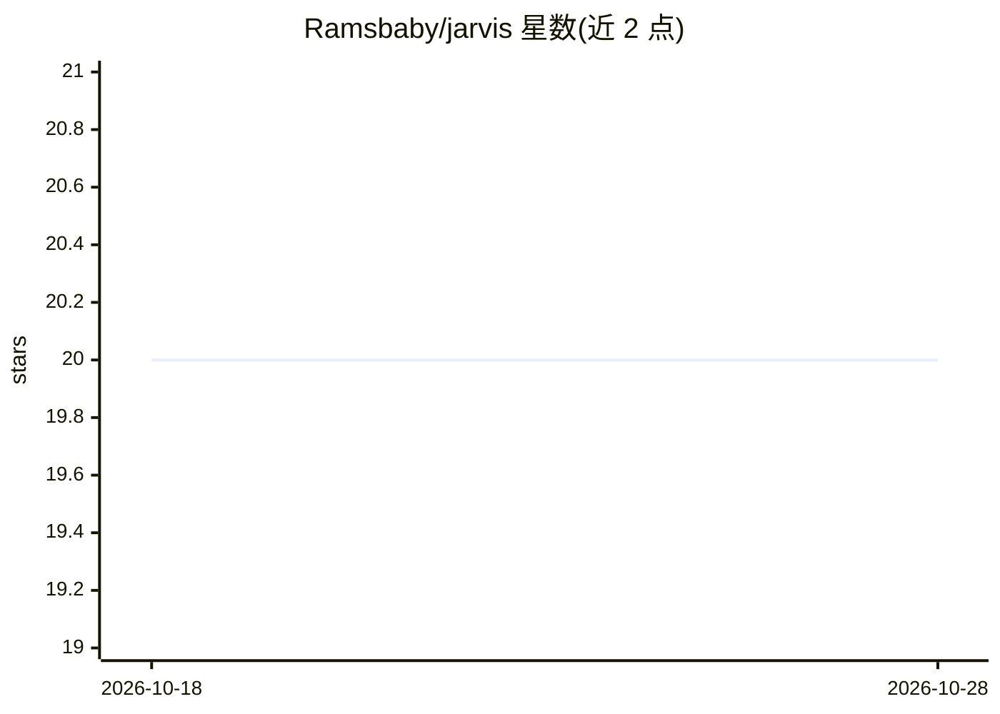

# Ramsbaby/jarvis

⭐ 20 · Shell · MIT · 推送 2026-10-21 · [GitHub](https://github.com/Ramsbaby/jarvis) · 个人维护

**自托管 24/7 个人 AI 运维平台（Discord 机器人+RAG+自动化），已冻结存档**

冻结的参考快照（2026-10-13，v2.60.6），作者设置已迁移至 OpenClaw，不再开发、无支持。原栈以 Discord 文字/语音为界面，Claude CLI 为大脑，配 LanceDB RAG 知识库、LLM Wiki、8 个 AI agent 团队、358 个自动化脚本与 136 个定时任务，含自愈看门狗；数据全部本地。快照仅重新验证了干净克隆后 Discord bot 启动到登录步骤（macOS arm64、Node 22+），RAG、cron 集群与安装向导未重测，README 列出安装向导与 bot 路径不一致等已知缺口。

## 筛选速览

| 维度 | 判定 | 备注 |
|---|---|---|
| AI 角色 | `ai-native` | 本体是模型或模型工具 |
| 许可风险 | `permissive` | MIT |
| 部署形态 | `library` | 以包/库形式分发 |
| 模型依赖 | local-ok | 支持本地模型 |
| 硬件要求 | — | 无带数字的原话,不猜 |
| 安装摩擦 | `low` | 无编译、无系统依赖或容器化 |
| 成熟度 | — | 结构信号不足 |

## 能力要点

- Discord 文字/语音界面 + Claude CLI 驱动，60+ 技能与 40+ 斜杠命令
- RAG（LanceDB，BM25+向量混合检索 10,000+ 文档）+ LLM Wiki + Insight Layer
- 358 个自动化脚本、136 个定时任务与 3 分钟自愈看门狗
- 快照状态：不再开发，仅验证了最小启动路径

## 适用场景

- 阅读或 fork 一套已冻结的自托管个人 AI 助手参考实现
- 了解 Discord bot + RAG + 自愈自动化的个人 AI 运维架构
- 需要维护版本时转向作者指明的 OpenClaw

## 场景标签

`AI 助手` `RAG` `工作流自动化` · 领域:效率与自动化

## 证据(README 行号)

> L36:  AI operations platform that manages itself 24/7
> L61: Message it on Discord and it chats. Send a voice message and it understands. Drop a file and it remembers.
> L66: **In short**: A personal AI operations platform. Runs 24/7, fixes itself when it breaks, gets smarter as you use it

## 星数曲线

2026-10-18 20 → 2026-10-28 20（+0）

---
*卡片 v1 · prompt 1.4 · 生成 2026-10-28 · 置信度 high · 依据 README sha `35ab64983ece` · [字段定义](../../DATASET.md)*
