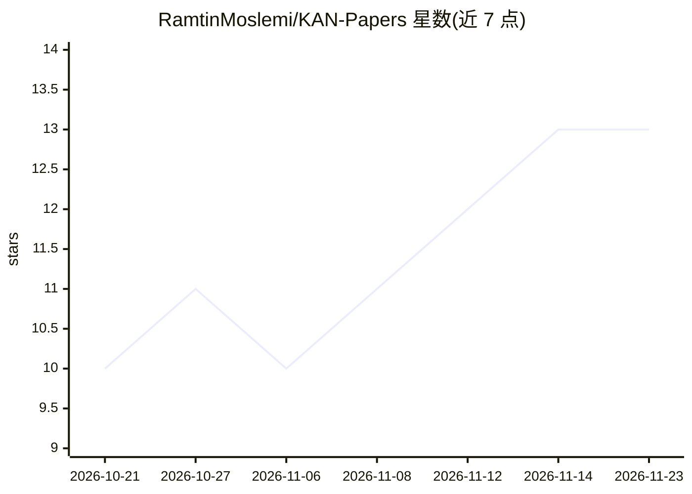

# RamtinMoslemi/KAN-Papers

⭐ 13 · Jupyter Notebook · MIT · 推送 2026-05-19 · [GitHub](https://github.com/RamtinMoslemi/KAN-Papers) · [官网](https://ramtinmoslemi.github.io/KAN-Papers/) · 个人维护

**KAN 论文聚合清单：按月整理 Kolmogorov-Arnold 网络文献**

从 arXiv 抽取的 Kolmogorov-Arnold Networks (KAN) 论文清单，收录每篇论文的标题、摘要、作者、链接、日期与引用数，按提交月份组织，并排除提交时间早于原始 KAN 论文的文献。另提供按月论文数量统计、标题与摘要词云，以及可在 Colab/Kaggle 打开的交互式笔记本，论文数据存储为 CSV 文件。

## 筛选速览

| 维度 | 判定 | 备注 |
|---|---|---|
| AI 角色 | `ai-knowledge` | 知识聚合/清单类 |
| 许可风险 | `permissive` | MIT |
| 部署形态 | `None` |  |
| 模型依赖 | — | README 未给出锁定关系 |
| 硬件要求 | — | 无带数字的原话,不猜 |
| 安装摩擦 | `medium` | 含编译或系统依赖之一 |
| 成熟度 | — | 结构信号不足 |

## 能力要点

- 收录 KAN 论文的标题、摘要、作者、链接、日期与引用数
- 按月组织论文并提供月度提交量统计
- 提供论文标题与摘要的词云
- 附可在 Colab/Kaggle 运行的笔记本，数据以 CSV 文件存储

## 适用场景

- 查找 Kolmogorov-Arnold Networks 方向的研究文献
- 调研 KAN 在时间序列预测、函数逼近等任务上的应用论文
- 了解 KAN 领域论文的月度趋势与高频主题词

## 场景标签

`精选清单` `科研工具` · 领域:学习与行业

## 证据(README 行号)

> L1: # Kolmogorov-Arnold Network Papers
> L2: A complete list of papers on KANs. Papers with submission dates before the original KAN papers are excluded. You mig
> L4: ## Papers by Month

## 星数曲线

2026-10-21 10 → 2026-11-23 13（+3）

---
*卡片 v1 · prompt 1.4 · 生成 2026-11-18 · 置信度 high · 依据 README sha `8feacdff4252` · [字段定义](../../DATASET.md)*
