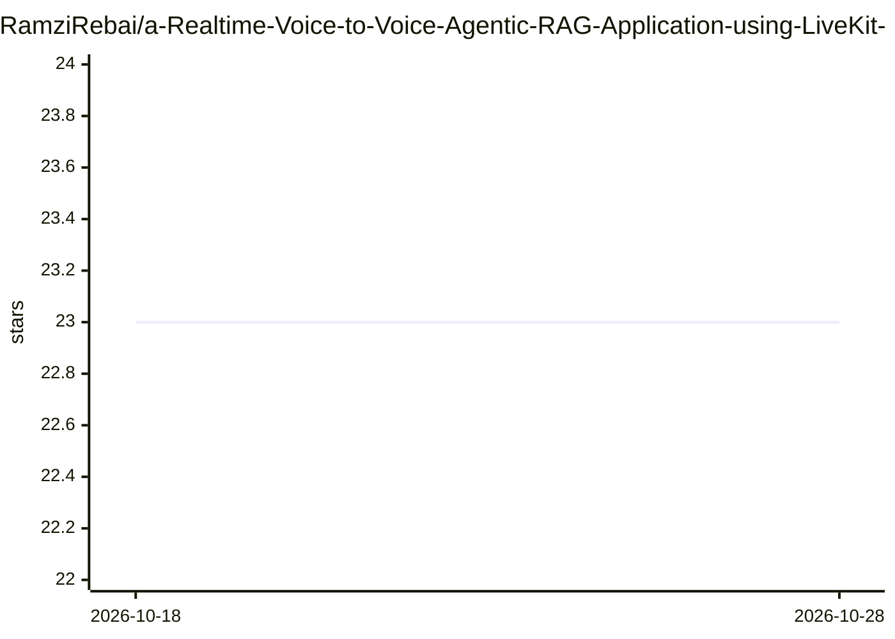

# RamziRebai/a-Realtime-Voice-to-Voice-Agentic-RAG-Application-using-LiveKit-and-Redis

⭐ 23 · 推送 2025-11-08 · [GitHub](https://github.com/RamziRebai/a-Realtime-Voice-to-Voice-Agentic-RAG-Application-using-LiveKit-and-Redis) · 个人维护

**实时语音对话分析 PDF 的语音 Agent 应用（LiveKit+Redis）**

基于 Next.js 前端与 Python LiveKit Agent 后端的语音助手应用：用户上传 PDF 后以自然语音提问，经 Deepgram STT、OpenAI GPT-4 与 OpenAI TTS 组成的低延迟管线获得语音回答；RAG 检索基于 Redis 向量存储与 OpenAI Embeddings，支持会话历史持久化、多用户认证（Supabase）与实时转写。需自行准备 Redis 实例与 OpenAI/Deepgram/LiveKit API key，从源码分别启动 agent 与前端。

## 筛选速览

| 维度 | 判定 | 备注 |
|---|---|---|
| AI 角色 | `ai-native` | 本体是模型或模型工具 |
| 许可风险 | `none` | — |
| 部署形态 | `library` | 以包/库形式分发 |
| 模型依赖 | — | README 未给出锁定关系 |
| 硬件要求 | — | 无带数字的原话,不猜 |
| 安装摩擦 | `low` | 无编译、无系统依赖或容器化 |
| 成熟度 | — | 结构信号不足 |

## 能力要点

- STT→LLM→TTS 实时语音管线（Deepgram/OpenAI/LiveKit）
- RAG 文档检索：Redis 向量存储 + OpenAI Embeddings + PyMuPDF4LLM
- 聊天历史跨会话持久化与多用户认证
- 实时转写与拖拽式 PDF 上传界面

## 适用场景

- 用语音向 AI 询问 PDF 文档内容并得到语音回答
- 上传文档后获取摘要或特定信息分析
- 多用户环境下进行带历史记录的语音问答

## 场景标签

`语音 Agent` `文档问答` · 领域:对话与助手

## 证据(README 行号)

> L17: - **Real-time Voice Interaction**: Natural voice conversations with AI assistant
> L31: - **RAG (Retrieval Augmented Generation)**: Advanced document retrieval for accurate responses
> L59: - **OpenAI GPT-4** - Large Language Model

## 星数曲线

2026-10-18 23 → 2026-10-28 23（+0）

---
*卡片 v1 · prompt 1.4 · 生成 2026-10-27 · 置信度 high · 依据 README sha `2e19769aaab6` · [字段定义](../../DATASET.md)*
