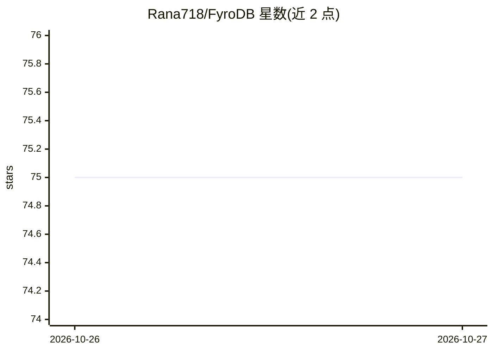

# Rana718/FyroDB

⭐ 75 · Rust · NOASSERTION · 推送 2026-10-28 · [GitHub](https://github.com/Rana718/FyroDB) · [官网](https://fyrodb.vercel.app/) · 个人维护

**Rust 编写的 Redis 兼容内存 KV 存储与 PostgreSQL 查询缓存代理**

单个 Rust 二进制提供两个功能：KV 引擎讲 RESP2/RESP3 协议，任何 Redis 客户端可直接连接，支持 String/Hash/List/JSON/Stream/向量搜索/全文搜索等数据类型；DB 缓存代理讲 PostgreSQL 线协议，应用只改一个环境变量即可接入，首个 SQL 模式查询转发至上游 Postgres 并缓存，后续相同查询从内存返回（约 1µs）。基于自研 customhash 分片无锁并发哈希表。通过 Docker 镜像或 cargo 源码编译安装，提供 RDB 快照与代理 TTL/模式等配置项。README 中列有与 Redis Cluster（12 节点）的基准对比数据。

## 筛选速览

| 维度 | 判定 | 备注 |
|---|---|---|
| AI 角色 | `ai-enhanced` | 去掉 AI 部分产品仍成立 |
| 许可风险 | `none` | NOASSERTION |
| 部署形态 | `self-host` | docker 或自建部署 |
| 模型依赖 | — | README 未给出锁定关系 |
| 硬件要求 | — | 无带数字的原话,不猜 |
| 安装摩擦 | `low` | 无编译、无系统依赖或容器化 |
| 成熟度 | — | 结构信号不足 |

## 能力要点

- RESP2/RESP3 兼容 KV 引擎，任何 Redis 客户端可直接使用
- PostgreSQL 线协议缓存代理，改环境变量即可接入，相同查询约 1µs 返回
- 数据类型含 JSON、向量搜索、全文搜索、Stream、HyperLogLog 等
- 基于 customhash 无锁并发哈希表，支持 RDB 快照

## 适用场景

- 用单个二进制替换现有 Redis 客户端连接的 KV 存储
- 为 PostgreSQL 应用加一层查询结果缓存而不改代码
- 在内存 KV 中做向量与全文检索

## 场景标签

`向量数据库` · 领域:知识与检索

## 证据(README 行号)

> L8: A Redis-compatible in-memory KV store **and** a PostgreSQL query caching proxy — both in one Rust binary. The KV eng
> L52: **Data types:** String · Hash · List · Set · Sorted Set · JSON · Stream · Bitmap · HyperLogLog · Geospatial · Vecto

## 星数曲线

2026-10-26 75 → 2026-10-27 75（+0）

---
*卡片 v1 · prompt 1.4 · 生成 2026-10-27 · 置信度 low · 依据 README sha `72e0e12b2f8d` · [字段定义](../../DATASET.md)*
