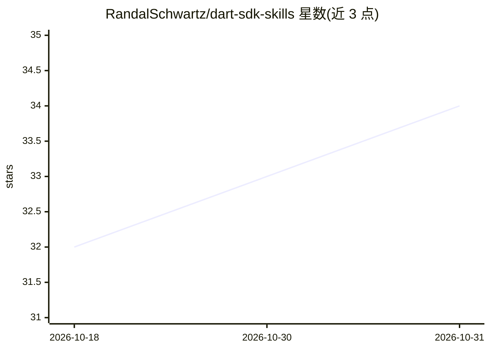

# RandalSchwartz/dart-sdk-skills

⭐ 34 · Dart · MIT · 推送 2026-10-29 · [GitHub](https://github.com/RandalSchwartz/dart-sdk-skills) · 个人维护

**Dart/Flutter SDK 版本知识技能包：补齐 AI 编程代理的知识空档**

面向 AI 编程代理的 SKILL.md 格式技能仓库，收录两大技能：dart-sdk-changelog 覆盖 Dart 语言特性、实验性 flag、宏与 Augmentations、版本矩阵及 Dart 1.x 遗留代码迁移流水线；flutter-sdk-changelog 覆盖 Widget 弃用替换对照、Material 2→3 迁移、Flutter 版本与捆绑 Dart SDK 映射及旧版 Flutter 应用分阶段迁移。目标是弥补 LLM 训练截止造成的 SDK 知识空档，使 Claude Code、Cursor、GitHub Copilot 等代理在各版本 SDK 下产出正确代码。通过 npx skills、Dart skills CLI 或手动克隆安装。

## 筛选速览

| 维度 | 判定 | 备注 |
|---|---|---|
| AI 角色 | `ai-knowledge` | 知识聚合/清单类 |
| 许可风险 | `permissive` | MIT |
| 部署形态 | `library` | 以包/库形式分发 |
| 模型依赖 | — | README 未给出锁定关系 |
| 硬件要求 | — | 无带数字的原话,不猜 |
| 安装摩擦 | `low` | 无编译、无系统依赖或容器化 |
| 成熟度 | — | 结构信号不足 |

## 能力要点

- 两大技能：dart-sdk-changelog 与 flutter-sdk-changelog
- 语言特性→最低 SDK 版本矩阵与 Widget 弃用替换对照表
- Dart 1.x / Flutter 1.0 遗留代码的分阶段迁移 runbook
- npx skills / Dart skills CLI / 手动符号链接三种安装途径

## 适用场景

- 让 Claude Code、Cursor 等编程代理写出版本正确的 Dart/Flutter 代码
- 查询语言特性或 Widget 的最低 SDK 与现代替代 API
- 迁移 Dart 1.x 或旧版 Flutter 遗留代码库

## 场景标签

`提示工程` · 领域:Agent 开发

## 证据(README 行号)

> L6: Authoritative, version-by-version agent skills for the **Dart & Flutter SDKs**: language features, core APIs, experi
> L8: Designed to bridge LLM training cutoff gaps, ensuring AI coding agents (Claude Code, Google Antigravity, OpenAI Code
> L42: This repository bundles two top-level, progressively disclosed skills:

## 星数曲线

2026-10-18 32 → 2026-10-31 34（+2）

---
*卡片 v1 · prompt 1.4 · 生成 2026-10-26 · 置信度 high · 依据 README sha `33c01a9016d4` · [字段定义](../../DATASET.md)*
