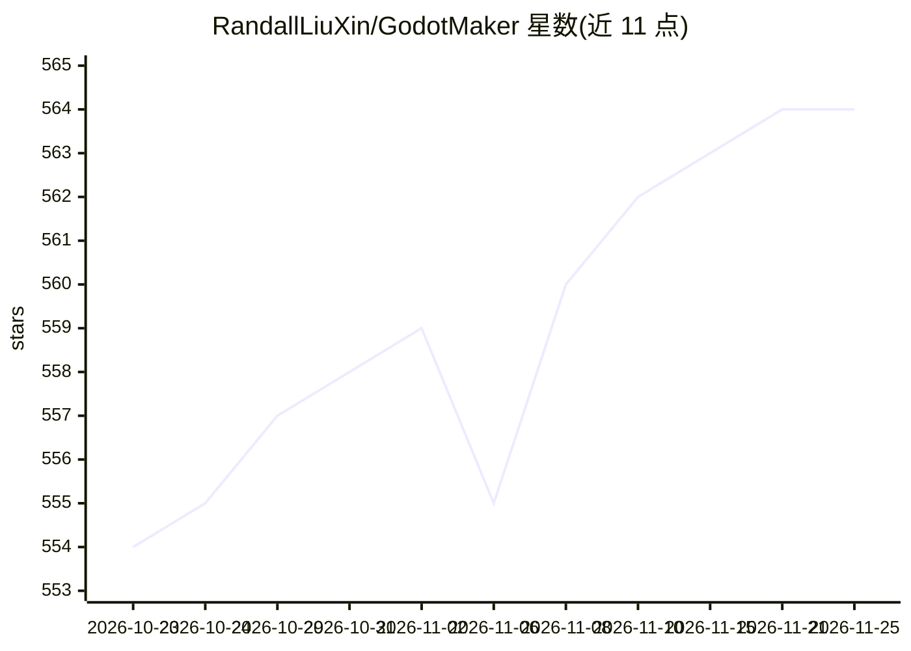

# RandallLiuXin/GodotMaker

⭐ 564 · Python · NOASSERTION · 推送 2026-10-23 · [GitHub](https://github.com/RandallLiuXin/GodotMaker) · [官网](https://randallliuxin.github.io/GodotMaker/) · 个人维护 · 中文 README

**用 AI agent 从文字想法自动生成可玩 Godot 游戏的流水线**

一个驱动 Claude Code/Codex/OpenCode/Pi 等 CLI agent 运行时的自动化工作流层：把自然语言游戏想法转成 GDD 设计契约，再由 agent 完成规划、Godot 代码实现、gdUnit4 单元测试、端到端玩法测试、截图与评估修复循环，产出常规 Godot 项目。工作流 local-first，代码留在本机；仅支持 2D 游戏，美术管线处于 alpha，音频生成不支持；单个小原型约需 5-8 小时 agent 运行时间。

## 筛选速览

| 维度 | 判定 | 备注 |
|---|---|---|
| AI 角色 | `ai-native` | 本体是模型或模型工具 |
| 许可风险 | `none` | NOASSERTION |
| 部署形态 | `library` | 以包/库形式分发 |
| 模型依赖 | — | README 未给出锁定关系 |
| 硬件要求 | — | 无带数字的原话,不猜 |
| 安装摩擦 | `low` | 无编译、无系统依赖或容器化 |
| 成熟度 | `idea` | |

## 能力要点

- 从自然语言想法到完整 Godot 项目（源码、场景、资产、测试、截图、报告）
- 默认无人工介入的长时运行，含测试-截图-评估-修复循环
- CLI 驱动，可切换 codex/opencode/pi 等多种 agent 运行时
- 生成物为标准 Godot 4.5+ 项目，可继续调试、扩展、发布

## 适用场景

- 把游戏点子快速变成可玩原型验证可行性与趣味性
- 游戏团队在立项前低成本试错多个玩法概念
- 在本地持续迭代由 AI 生成的 Godot 2D 游戏项目

## 场景标签

`编码 Agent` · 领域:编码与开发

## 证据(README 行号)

> L37: GodotMaker takes a different path: bring the game idea, let it shape that idea into a GDD, then let agents run thro
> L58: - turn your idea into `GDD.md`, tasks, scenes, systems, assets, and acceptance criteria
> L103: |Claude Code, Codex, OpenCode, or Pi|Command-line agent runtime for CLI-driven runs; desktop chat apps are not suf

## 星数曲线

2026-10-23 554 → 2026-11-25 564（+10）

---
*卡片 v1 · prompt 1.4 · 生成 2026-11-25 · 置信度 mid · 依据 README sha `baf589f7eb0d` · [字段定义](../../DATASET.md)*
