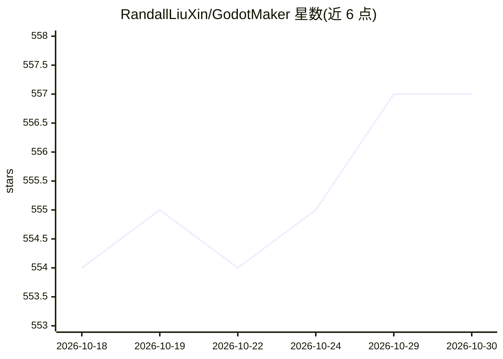

# RandallLiuXin/GodotMaker

⭐ 557 · Python · NOASSERTION · 推送 2026-10-23 · [GitHub](https://github.com/RandallLiuXin/GodotMaker) · [官网](https://randallliuxin.github.io/GodotMaker/) · 个人维护 · 中文 README

**文本到可玩游戏的自动化流水线，产出本地 Godot 工程**

面向游戏早期创意验证的工作流层：输入游戏想法后，由外部编码 agent（Claude Code、Codex、OpenCode、Pi）自动完成 GDD 规划、Godot 实现、gdUnit4 单测、端到端测试、运行截图、对照 GDD 评估与修复循环，产出用户磁盘上的普通 Godot 4 项目，代码归用户。以 npm 安装的 CLI 驱动端到端流程，默认无人值守，小型原型约 5-8 小时 agent 运行时间。当前限 2D，美术管线处于 alpha，TileMap/音频生成未支持，依赖外部 agent 运行时与模型提供商的计费策略。

## 筛选速览

| 维度 | 判定 | 备注 |
|---|---|---|
| AI 角色 | `ai-ecosystem` | LLM/agent 周边工具 |
| 许可风险 | `none` | NOASSERTION |
| 部署形态 | `library` | 以包/库形式分发 |
| 模型依赖 | — | README 未给出锁定关系 |
| 硬件要求 | — | 无带数字的原话,不猜 |
| 安装摩擦 | `low` | 无编译、无系统依赖或容器化 |
| 成熟度 | `idea` | |

## 能力要点

- 想法→GDD→实现→测试→截图→评估→修复的自动循环
- 产出本地标准 Godot 工程，代码归用户
- 支持 Claude Code / Codex / OpenCode / Pi 多种 agent 运行时
- CLI 端到端驱动，agent 选择支持多级配置覆盖

## 适用场景

- 把游戏想法快速变成可玩原型做可行性验证
- 通过迭代 GDD 持续提升生成游戏质量
- 在本地 Godot 生态中继续调试、扩展与发布生成的项目

## 场景标签

`工作流自动化` `编码 Agent` · 领域:效率与自动化

## 证据(README 行号)

> L37: GodotMaker takes a different path: bring the game idea, let it shape that idea into a GDD, then let agents run thro
> L143: GodotMaker itself is a workflow layer. Actual execution depends on external agent runtimes. These agents are not c

## 星数曲线

2026-10-18 554 → 2026-10-30 557（+3）

---
*卡片 v1 · prompt 1.4 · 生成 2026-10-21 · 置信度 mid · 依据 README sha `761c815975f9` · [字段定义](../../DATASET.md)*
