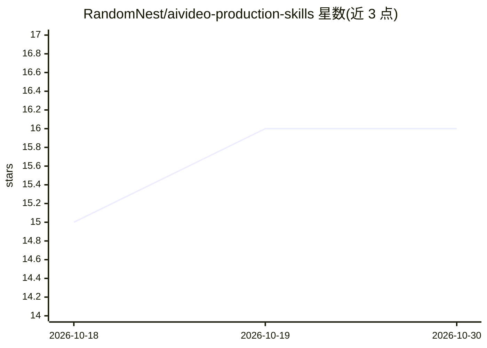

# RandomNest/aivideo-production-skills

⭐ 16 · MIT · 推送 2026-02-20 · [GitHub](https://github.com/RandomNest/aivideo-production-skills) · 个人维护

**AI 影视叙事生产的门控式技能框架：连续性控制与成本治理**

面向 AI 电影/剧集生产的模型无关框架，以 SKILL 形式提供叙事、验证、连续性、生产、治理、可观测六层能力：角色/场景/声音防漂移锁、世界状态追踪、叙事红队、QC 评分、regen 学习循环、成本路由与预算门控。全部连续性外置为版本化工件，门控不通过则循环回退，禁止只前进模式。模型按吞吐/判断/研究/视觉四档分层，优先用最廉价可用档。非提示词合集，定位为生产基础设施；需先阅读运行文档并初始化锁与世界状态后才能开始生成。

## 筛选速览

| 维度 | 判定 | 备注 |
|---|---|---|
| AI 角色 | `ai-ecosystem` | LLM/agent 周边工具 |
| 许可风险 | `permissive` | MIT |
| 部署形态 | `None` |  |
| 模型依赖 | — | README 未给出锁定关系 |
| 硬件要求 | — | 无带数字的原话,不猜 |
| 安装摩擦 | `low` | 无编译、无系统依赖或容器化 |
| 成熟度 | — | 结构信号不足 |

## 能力要点

- 六层架构：叙事/验证/连续性/生产/治理/可观测，含 20+ 技能模块
- 工件化记忆：版本化锁、append-only 日志、世界状态 diff
- 闭环工作流：QC 与 regen 失败循环回退，无只前进模式
- 模型分层路由（吞吐/判断/研究/视觉）与预算门控

## 适用场景

- 制作 50+ 场景的长篇 AI 影视并保持角色与世界观连续性
- 为 AI 生成管线设置成本上限与模型升级策略
- 对生成内容做红队审查、合理性审计与 QC 评分

## 场景标签

`多智能体` `工作流自动化` `视频生成` · 领域:Agent 开发

## 证据(README 行号)

> L31: AI Video Production Skills is a model-agnostic, production-grade framework for building AI-assisted films and serie
> L83: ### 4. Model-Agnostic Routing
> L267: This is production infrastructure.

## 星数曲线

2026-10-18 15 → 2026-10-30 16（+1）

---
*卡片 v1 · prompt 1.4 · 生成 2026-10-30 · 置信度 mid · 依据 README sha `4c3ff6ba43d5` · [字段定义](../../DATASET.md)*
