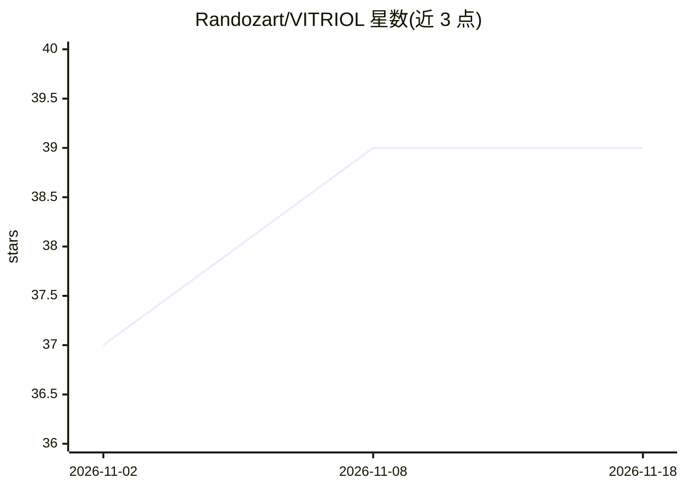

# Randozart/VITRIOL

⭐ 39 · C++ · Apache-2.0 · 推送 2026-11-17 · [GitHub](https://github.com/Randozart/VITRIOL) · 个人维护

**面向老旧/低显存硬件的本地 LLM 推理引擎（llama.cpp 分支）**

llama.cpp 的 in-tree 分支，目标是让通常无法运行模型的受限硬件（显存不足的 GPU、窄 PCIe 总线、无现代向量指令的 CPU、DDR3 内存）跑通并加速本地 LLM 推理。机制包括：模型放不下时将 MoE 专家张量驻留页锁定主机内存经 PCIe DMA 流式传输（流式模式），配合 LRU 显存缓存、专家固定与预测预取；模型放得下时驻留显存并优化上下文——TurboQuant KV 量化（3.5 bpw）、注意力探针稀疏逐出、MTP 投机解码。另内置全屏 agentic 编程环境 Officina 与路由守护 Demiurge（本地→节点→免费云→限额付费的分级路由）。README 声明并非稳定仓库，且整棵树针对一台特定机器调优。

## 筛选速览

| 维度 | 判定 | 备注 |
|---|---|---|
| AI 角色 | `ai-ecosystem` | LLM/agent 周边工具 |
| 许可风险 | `permissive` | Apache-2.0 |
| 部署形态 | `None` |  |
| 模型依赖 | local-ok | 支持本地模型 |
| 硬件要求 | — | 无带数字的原话,不猜 |
| 安装摩擦 | `medium` | 含编译或系统依赖之一 |
| 成熟度 | `idea` | |

## 能力要点

- RAM Shot 流式模式：MoE 专家驻留主机 RAM，经 PCIe DMA 按需读入 GPU
- TurboQuant KV 3.5 bpw 量化与探针评分稀疏逐出，按已填充 token 计测量认证深度
- 内置 Officina 编程工作台（经 HTTP 与引擎耦合）与 Demiurge 分级路由守护
- 崩溃恢复与运维层：systemd 单元、oom-shield、hang watchdog、暖恢复 KV 检查点

## 适用场景

- 在老 GPU/窄 PCIe/无 AVX2 的旧台式机上运行本地大模型
- 显存不够装下 MoE 模型权重时流式跑推理
- 在一台机器上获得带编程工作台的本地推理一体环境

## 场景标签

`推理引擎` `模型量化` `编码 Agent` · 领域:编码与开发

## 证据(README 行号)

> L17: VITRIOL is a fork of llama.cpp whose
> L18: goal is **optimal inference on machines that are normally too constrained to
> L20: modern vector instructions, DDR3-era memory, single-digit-gigabyte boxes.

## 星数曲线

2026-11-02 37 → 2026-11-18 39（+2）

---
*卡片 v1 · prompt 1.4 · 生成 2026-11-18 · 置信度 high · 依据 README sha `355fe27c00e4` · [字段定义](../../DATASET.md)*
