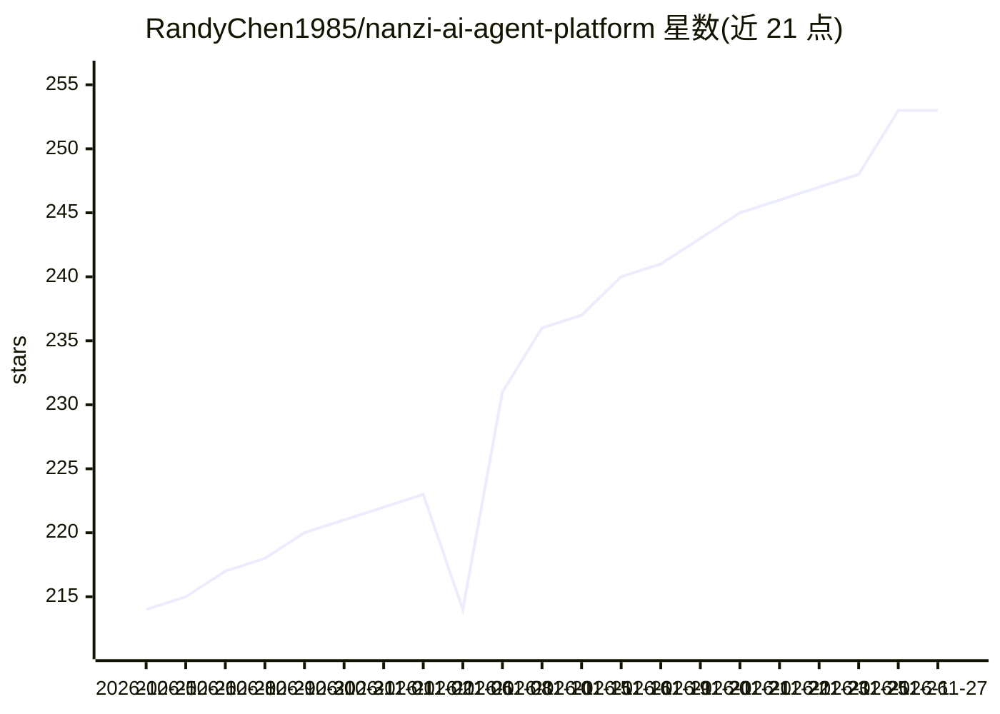

# RandyChen1985/nanzi-ai-agent-platform

⭐ 253 · Python · MIT · 推送 2026-11-26 · [GitHub](https://github.com/RandyChen1985/nanzi-ai-agent-platform) · 个人维护 · 中文 README

**企业级多智能体编排与 ChatBI 数据分析平台**

基于 AgentScope 与 FastAPI 的智能体平台，提供多 Agent 委派与协同、RAGFlow 知识库、ChatBI Text-to-SQL 自愈分析、五大策略安全沙箱（Local/Docker/K8s/E2B/SSH）、Redis 长期记忆、持久化浏览器自动化、嵌入式 Chat SDK、定时任务与多通道推送、RBAC 权限与 Token 审计。部署依赖 MySQL/PostgreSQL 与 Redis，推荐 Docker 构建镜像运行，另有微信实战连载与 FAQ 文档。面向企业内部搭建智能体应用与数据问答场景。

## 筛选速览

| 维度 | 判定 | 备注 |
|---|---|---|
| AI 角色 | `ai-ecosystem` | LLM/agent 周边工具 |
| 许可风险 | `permissive` | MIT |
| 部署形态 | `self-host` | docker 或自建部署 |
| 模型依赖 | local-ok | 支持本地模型 |
| 硬件要求 | — | 无带数字的原话,不猜 |
| 安装摩擦 | `low` | 无编译、无系统依赖或容器化 |
| 成熟度 | — | 结构信号不足 |

## 能力要点

- 多 Agent 智能委派与专家直选，AgentScope ReAct 执行引擎
- ChatBI：Text-to-SQL 闭环、SQL 自愈与 Schema 漂移治理
- 五策略安全沙箱（Local/Docker/K8s/E2B/SSH）与持久化浏览器接管面板
- 内置多提供商模型预设、RBAC、SSO 与 Token 消耗审计

## 适用场景

- 企业内搭建多专家协作的智能体助手并嵌入业务系统
- 业务人员用自然语言直查 Oracle/ClickHouse/MySQL 数仓生成报表
- 建设知识库并让对话自动检索注入引用
- 定时巡检数据报表并通过企微/钉钉/飞书推送告警

## 场景标签

`Agent 框架` `多智能体` `数据分析` `聊天机器人` · 领域:Agent 开发

## 证据(README 行号)

> L10: > **企业级 AI 智能体编排与执行平台**
> L29: * 💬 **深度交互式对话 (Dialogue & Co-Agent)**：极速流式响应，支持 **智能委派（默认进入 Main）** 与 **专家模式 / @提及直选**、多专家协同。内置 **工具预检** 促发模型主动调用工具
> L132: * **多提供商模型管理**：内置 OpenAI, Azure, DeepSeek, Kimi, 智谱 AI, 硅基流动, 阿里云百炼, 火山引擎 (Ark/豆包), Ollama 等模型预设与 Endpoint 智能版本号规范

## 星数曲线

2026-10-25 214 → 2026-11-27 253（+39）

---
*卡片 v1 · prompt 1.4 · 生成 2026-11-25 · 置信度 mid · 依据 README sha `91af2d3db5b2` · [字段定义](../../DATASET.md)*
