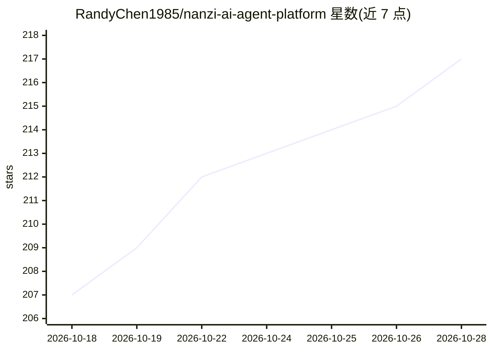

# RandyChen1985/nanzi-ai-agent-platform

⭐ 218 · Python · MIT · 推送 2026-10-28 · [GitHub](https://github.com/RandyChen1985/nanzi-ai-agent-platform) · 个人维护 · 中文 README

**面向企业的多智能体编排与 ChatBI 平台，数据直连+RAG**

个人开源（MIT）的企业级 AI 智能体编排与执行平台：基于 AgentScope + FastAPI 的 6 阶段异步流水线，提供智能委派多 Agent 协作、Local/Docker/K8s/E2B/SSH 五种沙箱执行策略、ChatBI Text-to-SQL 与自愈、RAG 知识库、Redis 长期记忆、双向 MCP 生态（含 OAuth2 对外 MCP 服务）、定时任务多通道推送与 RBAC 权限审计。支持多模型提供商接入（OpenAI/DeepSeek/Kimi/智谱/Ollama 等）。部署需配置数据库与 Redis，主库为 MySQL，可选 PostgreSQL，通过 Docker 构建脚本导出镜像部署。

## 筛选速览

| 维度 | 判定 | 备注 |
|---|---|---|
| AI 角色 | `ai-ecosystem` | LLM/agent 周边工具 |
| 许可风险 | `permissive` | MIT |
| 部署形态 | `self-host` | docker 或自建部署 |
| 模型依赖 | local-ok | 支持本地模型 |
| 硬件要求 | — | 无带数字的原话,不猜 |
| 安装摩擦 | `low` | 无编译、无系统依赖或容器化 |
| 成熟度 | — | 结构信号不足 |

## 能力要点

- Local/Docker/K8s/E2B/SSH 五种沙箱执行策略，含空闲回收与生命周期管理
- ChatBI：元数据注入+Schema 门禁+SQL 自愈与 sql_plan 结构化计划
- 双向 MCP：出站自动透传用户身份，平台自身作为 MCP 服务端供 Cursor/Claude Desktop 调用
- 四维 Token 占比观测与两阶段上下文溢出压缩

## 适用场景

- 企业搭建带 RBAC 与审计的内部智能体问答/分析平台
- 自然语言直查业务数仓并生成证据化业务简报
- 通过嵌入式 Chat SDK 将智能体能力集成到现有业务系统
- 外部 MCP 客户端调用平台纳管的智能体与会话

## 场景标签

`Agent 框架` `多智能体` `数据分析` `RAG` · 领域:Agent 开发

## 证据(README 行号)

> L10: > **企业级 AI 智能体编排与执行平台**
> L25: **NanZi 智能体平台** 是专为企业级复杂场景打造的 AI 智能中枢。

## 星数曲线

2026-10-18 207 → 2026-10-28 217（+10）

---
*卡片 v1 · prompt 1.4 · 生成 2026-10-22 · 置信度 mid · 依据 README sha `4c45e0d8584c` · [字段定义](../../DATASET.md)*
