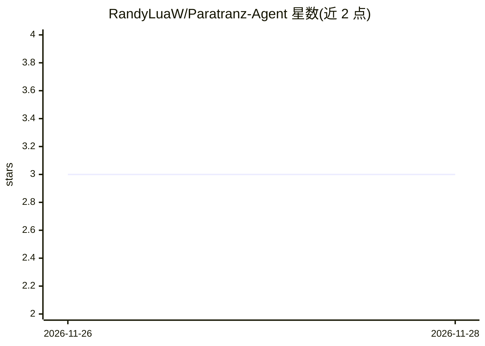

# RandyLuaW/Paratranz-Agent

⭐ 3 · Python · NOASSERTION · 推送 2026-11-22 · [GitHub](https://github.com/RandyLuaW/Paratranz-Agent) · 个人维护 · 中文 README

**让 LLM Agent 自动化 ParaTranz 汉化项目全流程的工具**

以 Python 编写的 ParaTranz 汉化项目自动化工具：通过五条流水线（分派、翻译、校对、术语、规范）将切分任务、进度跟踪、QA 检查、术语维护等流程性工作交由 Agent 执行，并提供游戏文件与平台间的双向提取/回写链路。提供本地 WebUI 与 `ptz` 命令行两种入口，支持多 provider 模型管理与四维预算的成本控制；未配置模型 API 时直接报错。唯一硬依赖为 ParaTranz OpenAPI，Windows 提供免安装包，其余平台从源码安装（需 Python 3.11+）。

## 筛选速览

| 维度 | 判定 | 备注 |
|---|---|---|
| AI 角色 | `ai-native` | 本体是模型或模型工具 |
| 许可风险 | `none` | NOASSERTION |
| 部署形态 | `library` | 以包/库形式分发 |
| 模型依赖 | — | README 未给出锁定关系 |
| 硬件要求 | — | 无带数字的原话,不猜 |
| 安装摩擦 | `low` | 无编译、无系统依赖或容器化 |
| 成熟度 | — | 结构信号不足 |

## 能力要点

- 五条流水线：分派/翻译/校对/术语/规范，写操作默认 dry-run
- 游戏文件与平台双向同步，回写按 key 定位并带原文校验等三条安全约束
- 多 provider 模型管理与按任务路由，四维预算（单次/单任务/每日/每月）
- 本地 WebUI 含词条工作台，支持演练模式（--mock）

## 适用场景

- 自动化管理 ParaTranz 上的游戏汉化项目分派与进度
- 用模型批量翻译并让确定性 QA 规则先行校对
- 把平台确认的译文回写生成可直接运行的汉化版游戏目录

## 场景标签

`工作流自动化` `AI 写作` · 领域:效率与自动化

## 证据(README 行号)

> L19: **Paratranz Agent** 将上述流程交由 Agent 执行。本工具并非批量上传工具，而是一套**平台侧全流程自动化与本地文件双向同步**工具：以单条命令启动可视化控制台，可在界面中填写 Token、点击操作，或直接以
> L33: |**翻译** `translate`|翻译记忆精确命中时直接复用，其余分批提交模型（附术语表、TM 参考与风格要求）|占位符不一致的条目在本地即拦截，不写回平台|

## 星数曲线

2026-11-26 3 → 2026-11-28 3（+0）

---
*卡片 v1 · prompt 1.4 · 生成 2026-11-26 · 置信度 high · 依据 README sha `800021151b8d` · [字段定义](../../DATASET.md)*
