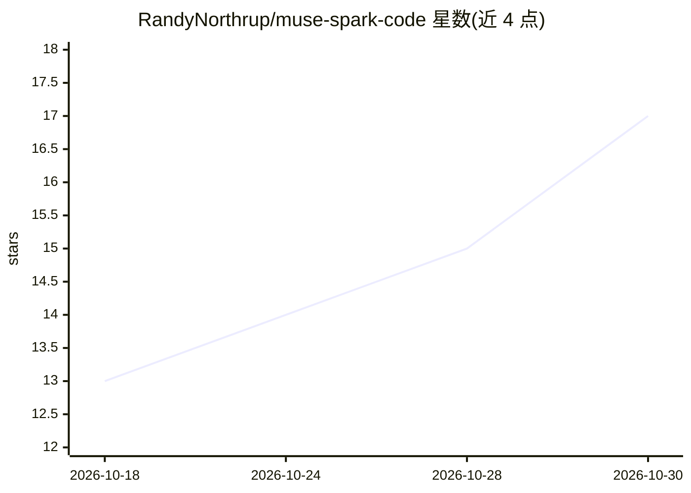

# RandyNorthrup/muse-spark-code

⭐ 17 · TypeScript · MIT · 推送 2026-10-28 · [GitHub](https://github.com/RandyNorthrup/muse-spark-code) · [官网](https://github.com/RandyNorthrup/muse-spark-code#install-in-your-editor) · 个人维护

**把 Meta Muse Spark 模型接入编辑器的编码 agent 扩展**

非官方的编码 agent：以扩展形式运行于 VS Code、Cursor、Windsurf、VSCodium 等 VS Code 系编辑器，并以 ACP agent 接入 Zed、JetBrains、Neovim、Emacs。聊天面板流式输出、读写文件并给出可审阅 diff、按权限模式执行命令、委派可在地图上查看的 subagent，支持记忆历史会话、语音听写（Linux 用离线 Whisper tiny.en）、MCP 与 15 种语言。后端为 Muse 订阅（Muse Code CLI）或 Meta Model API key，也提供自有 provider 预设（含 llama.cpp server、LM Studio）与本地 /report 报告（不调用模型）。

## 筛选速览

| 维度 | 判定 | 备注 |
|---|---|---|
| AI 角色 | `ai-native` | 本体是模型或模型工具 |
| 许可风险 | `permissive` | MIT |
| 部署形态 | `library` | 以包/库形式分发 |
| 模型依赖 | — | README 未给出锁定关系 |
| 硬件要求 | — | 无带数字的原话,不猜 |
| 安装摩擦 | `low` | 无编译、无系统依赖或容器化 |
| 成熟度 | — | 结构信号不足 |

## 能力要点

- 跨 VS Code 系编辑器与 ACP（Zed/JetBrains/Neovim/Emacs）运行同一 agent
- subagent 地图、工作流卡片与权限模式下的命令审批
- 语音听写：Windows/macOS 用系统识别器，Linux 用离线 Whisper tiny.en
- /report 本地报告（项目/里程碑/用量等 13 类）不调用模型不产生费用

## 适用场景

- 在现有编辑器里用 Muse Spark 模型做编码 agent
- 查看并审批 agent 的每次读写与命令执行
- 跟踪多 agent 委派与工作流运行状态

## 场景标签

`编码 Agent` · 领域:编码与开发

## 证据(README 行号)

> L18: **Muse Spark Code** puts Meta's Muse Spark model to work in your editor as a
> L24: takes dictation from your microphone. It runs on your Muse subscription

## 星数曲线

2026-10-18 13 → 2026-10-30 17（+4）

---
*卡片 v1 · prompt 1.4 · 生成 2026-10-30 · 置信度 high · 依据 README sha `22699ce138d3` · [字段定义](../../DATASET.md)*
