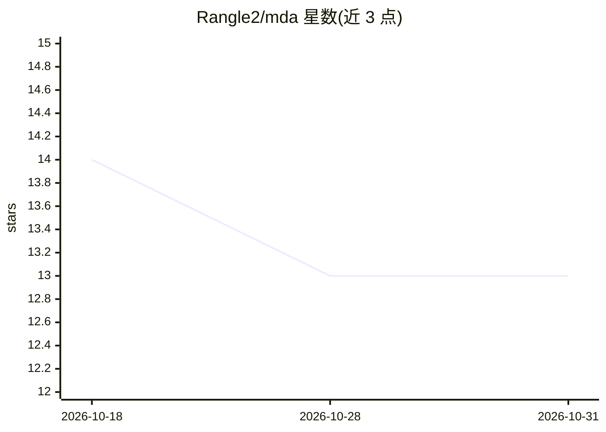

# Rangle2/mda

⭐ 13 · Python · NOASSERTION · 推送 2026-05-02 · [GitHub](https://github.com/Rangle2/mda) · 个人维护

**LLM 在线联想记忆层：对话中即时学习，无需重建索引**

面向 LLM 应用的持久记忆系统：将知识编码为 512 维全息分布式表示（HDR），通过稀疏突触图连接概念，检索时激活实体网络而非文本块相似度搜索。每轮对话中通过 Oja 规则在线更新权重，无反向传播，新知识即时整合且不覆盖旧知识（实体独立）。默认在 numpy 上 CPU 运行，PyTorch+CUDA 可用时自动启用 GPU。支持 Ollama、OpenAI、Anthropic、llama.cpp 等模型，并可作为 Open WebUI Filter Function 集成。以 pip 包提供，附 CLI 与批处理引擎。

## 筛选速览

| 维度 | 判定 | 备注 |
|---|---|---|
| AI 角色 | `ai-ecosystem` | LLM/agent 周边工具 |
| 许可风险 | `viral` | NOASSERTION |
| 部署形态 | `library` | 以包/库形式分发 |
| 模型依赖 | local-ok | 支持本地模型 |
| 硬件要求 | — | 无带数字的原话,不猜 |
| 安装摩擦 | `medium` | 含编译或系统依赖之一 |
| 成熟度 | — | 结构信号不足 |

## 能力要点

- Oja 规则在线学习，推理过程中更新记忆，无反向传播
- 512 维 HDR + 稀疏突触图，实体网络激活式检索，无需重建索引
- 实体独立存储避免灾难性遗忘
- CPU-first（numpy），PyTorch+CUDA 可用时自动 GPU 加速

## 适用场景

- 为对话应用提供跨轮次的长期记忆注入
- 需要对话中即时学习新知识的 LLM 场景
- 替代长上下文窗口维持 200 轮以上的历史记忆
- 作为 Open WebUI 的 Filter Function 添加记忆能力

## 场景标签

`Agent 记忆` · 领域:Agent 开发

## 证据(README 行号)

> L15: It encodes knowledge as **512-dimensional Holographic Distributed Representations (HDRs)**, connects concepts throu
> L52: Each turn, MDA retrieves relevant context from previous turns and injects it into the LLM prompt with confidence sc

## 星数曲线

2026-10-18 14 → 2026-10-31 13（-1）

---
*卡片 v1 · prompt 1.4 · 生成 2026-10-31 · 置信度 high · 依据 README sha `541fd19600ef` · [字段定义](../../DATASET.md)*
